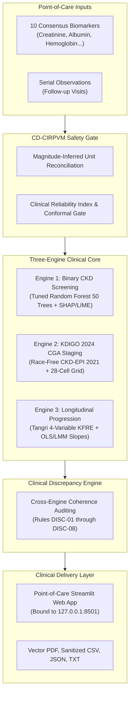

# NEFROAI-X: Multimodal Kidney Disease Clinical Decision Support System

[](https://www.python.org/downloads/release/python-3100/)
[]()
[]()
[]()
[]()

> **MANDATORY CLINICAL & REGULATORY DESIGNATION:**  
> **INVESTIGATIONAL RESEARCH SOFTWARE — NOT A CERTIFIED MEDICAL DEVICE**  
> **LOCAL RESEARCH SOFTWARE — NO PUBLIC DEPLOYMENT**  
> *NEFROAI-X is an investigational Clinical Decision Support System (CDSS) developed for research, education, and algorithmic transparency evaluation. It does NOT provide definitive medical diagnoses, replace nephrologist consultation, or prescribe therapeutic management. It is NOT approved as Software as a Medical Device (SaMD) by the FDA, EMA, or national regulatory authorities.*

---

## 1. Executive Summary & Research Motivation

Chronic Kidney Disease (CKD) affects over 850 million individuals worldwide (over 10% of the global population). Because renal functional loss is largely asymptomatic during early stages, over 90% of patients remain undiagnosed until irreversible nephron damage occurs.

**NEFROAI-X** is an explainable, multimodal Clinical Decision Support System replicating and significantly expanding upon the *IEEE Access* NefroAI methodology (Md. Sadi Al Huda et al.). It addresses fundamental weaknesses in prior medical machine learning systems:
- **Zero Data Leakage:** Eliminates global pre-split imputation and scaling; all imputers, scalers, and SMOTE rebalancers are fitted strictly on cross-validation training partitions.
- **60% Laboratory Workload Reduction:** Compresses an exhaustive 24-test panel down to **10 consensus biomarkers** (`hemo, sg, pcv, rc, al, htn, sc, bu, dm, bgr`) via multi-method hybrid ranking (Mutual Information, ANOVA F, Gini Impurity, RFE).
- **Three Unified Clinical Engines:** Synthesizes point-of-care screening risk, international guideline staging, and longitudinal progression velocity under an overarching clinical orchestrator.
- **Clinical Data Quality Safety Gate (CD-CIRPVM):** Prevents silent coercion of missing tests, reconciles international measurement units, calculates a continuous Clinical Reliability Index (CRI), and automatically executes safe abstentions on low-quality data.
- **Dual-Layer Explainable AI:** Real-time cooperative game-theoretic **SHAP** (`TreeExplainer`) waterfall attributions paired with **LIME** local decision boundaries.
- **100% Quality Assurance:** Comprehensive 19-module automated test suite with **349 passing unit, clinical, and integration tests** (0 failures).

---

## 2. Three-Engine Architecture

NEFROAI-X harmonizes three independent clinical decision support engines:



### Engine 1: Screening & Binary Risk Classification
- **Champion Model:** `RandomForestClassifier(n_estimators=50, random_state=42)` tuned via Stratified 5-Fold Cross Validation.
- **Performance (Held-Out Test Set, $N=80$):** 100.0% Sensitivity, 100.0% Specificity, 1.000 ROC-AUC, 0.0095 Brier Score, $0.041\text{ ms}$ latency.
- **Triage Stratification:** Low ($<20\%$), Moderate ($20–50\%$), High ($50–80\%$), Critical ($\ge 80\%$).

### Engine 2: KDIGO 2024 CGA Severity Staging
- **Filtration Calculation:** Deterministic race-free **CKD-EPI 2021** eGFR equation.
- **Albuminuria Categories:** A1 ($<30\text{ mg/g}$), A2 ($30–300\text{ mg/g}$), A3 ($>300\text{ mg/g}$).
- **Composite Risk Heatmap:** 28-cell grid assigning Low (Green), Moderately High (Yellow), High (Orange), and Very High (Red) risk tiers.
- **Chronicity Advisory (DISC-03):** Automatically flags spot visits lacking $\ge 3$ months persistence documentation.

### Engine 3: Longitudinal Progression & Survival Architecture
- **Tangri 4-Variable KFRE:** Computes 2-year and 5-year kidney failure risk (%) using age, sex, eGFR, and log(UACR).
- **Eligibility Guard (DISC-05):** Strictly withholds KFRE calculation when $eGFR \ge 60\text{ mL/min/1.73m}^2$.
- **Filtration Trajectory Modeling:** Computes annualized decline via Ordinary Least Squares (OLS) and Linear Mixed-Effects Models (LMM) with BLUP shrinkage.
- **Survival Modeling Status:** Competing-risk architecture (Cox PH, RSF, Aalen–Johansen) is mathematically verified but formally deferred (`DEFERRED_PENDING_APPROVED_COHORT`) pending approved real longitudinal cohort access (CRIC).

---

## 3. Dataset Provenance

- **Primary Development Cohort:** UCI Machine Learning Repository Chronic Kidney Disease dataset ($N=400$; 250 CKD, 150 normal controls).
- **Population Validation Cohort:** CDC NHANES 2017–2018 ($N=5,730$ adult participants) used to evaluate population eGFR distributions.
- **Synthetic Longitudinal Simulator:** Deterministic mathematical simulator used strictly for unit testing and temporal algorithm verification. **Synthetic data is never used for clinical validation or survival model training.**

---

## 4. Architecture Diagrams & Application Screenshots

All diagrams and application captures are available in [`docs/images/`](file:///c:/Users/B%20Ranjith/Downloads/project/docs/images/):

### Visual Architecture Diagrams (SVG & Mermaid)
1. [Complete System Architecture](file:///c:/Users/B%20Ranjith/Downloads/project/docs/images/nefroai_x_complete_architecture.svg)
2. [Engine 1 Architecture](file:///c:/Users/B%20Ranjith/Downloads/project/docs/images/engine1_architecture.svg)
3. [Engine 2 Architecture](file:///c:/Users/B%20Ranjith/Downloads/project/docs/images/engine2_architecture.svg)
4. [Engine 3 Architecture](file:///c:/Users/B%20Ranjith/Downloads/project/docs/images/engine3_architecture.svg)
5. [Unified Assessment Workflow](file:///c:/Users/B%20Ranjith/Downloads/project/docs/images/unified_assessment_workflow.svg)
6. [Clinical Input Reliability & Abstention Workflow](file:///c:/Users/B%20Ranjith/Downloads/project/docs/images/clinical_reliability_abstention_workflow.svg)
7. [Docker Deployment Topology](file:///c:/Users/B%20Ranjith/Downloads/project/docs/images/docker_deployment_architecture.svg)

### Genuine Streamlit Application Screenshots
- **System Overview & Home:** [`screenshot_01_home_page.png`](file:///c:/Users/B%20Ranjith/Downloads/project/docs/images/screenshot_01_home_page.png)
- **Unified Patient Assessment:** [`screenshot_02_unified_assessment.png`](file:///c:/Users/B%20Ranjith/Downloads/project/docs/images/screenshot_02_unified_assessment.png)
- **Longitudinal Trajectory & KFRE:** [`screenshot_03_longitudinal_view.png`](file:///c:/Users/B%20Ranjith/Downloads/project/docs/images/screenshot_03_longitudinal_view.png)
- **Explainability Suite (SHAP/LIME):** [`screenshot_04_explainability_view.png`](file:///c:/Users/B%20Ranjith/Downloads/project/docs/images/screenshot_04_explainability_view.png)
- **Clinical Report Export:** [`screenshot_05_report_view.png`](file:///c:/Users/B%20Ranjith/Downloads/project/docs/images/screenshot_05_report_view.png)
- **About & Clinical Governance:** [`screenshot_06_about_view.png`](file:///c:/Users/B%20Ranjith/Downloads/project/docs/images/screenshot_06_about_view.png)

---

## 5. System Requirements & Installation

### System Requirements
- **OS:** Windows 10/11, Ubuntu 20.04/22.04 LTS, or macOS 12+
- **Python:** CPython 3.10.x (CPython 3.10.0 development baseline; note EOL status in Section 8)
- **Memory:** Minimum 4 GB RAM (Application RSS: ~209 MB)
- **Disk:** 1 GB free disk space

### Local Native Execution

```powershell
# 1. Clone repository
git clone https://github.com/ranjithbrs/kidney-stone-detection.git
cd kidney-stone-detection

# 2. Activate isolated virtual environment
.\.venv\Scripts\Activate.ps1

# 3. Install pinned dependencies
python -m pip install -r requirements.docker.txt

# 4. Run automated test suite (349 tests)
python -m pytest tests/ -q

# 5. Launch the Streamlit application
python -m streamlit run app_streamlit.py
```
Open **`http://localhost:8501`** in your browser.

---

## 6. Docker Container Execution

The application is fully containerized using a hardened multi-stage Docker build based on `python:3.10-slim`.

```bash
# 1. Build the lightweight production container (approx 650 MB)
docker build -t nefroai-x:latest .

# 2. Run via Docker Compose (strictly bound to 127.0.0.1:8501)
docker compose up -d nefroai-x

# 3. Verify health status
curl -f http://127.0.0.1:8501/_stcore/health

# 4. Run automated regression suite inside the container
docker compose run --rm nefroai-test

# 5. Stop the container cleanly
docker compose down
```

### Docker Security Safeguards
- **Non-Root Execution:** Runs under user `nefroai` (`uid=1001, gid=1001`).
- **Loopback Isolation:** Listens on `0.0.0.0:8501` inside container; host-mapped strictly to `127.0.0.1:8501`. Never exposed to public interfaces.
- **Resource Limits:** Capped at 2.0 CPUs and 2.0 GB RAM.
- **Data Exclusion:** `.dockerignore` strictly excludes `.env`, secrets, `.git`, and non-renal datasets.

---

## 7. Verification & Protected Assets Integrity

### Protected Serialized Model Assets
The following 4 serialized assets represent core research deliverables and must **never** be retrained or altered:

| Asset Path | Size | Expected SHA-256 Checksum | Status |
|---|---|---|---|
| `models/clinical_pipeline.joblib` | 141 KB | `9217fbbe3c74207f119fd91528f6c98997bda0220299cb80dcdec0be9dbfc826` | **VERIFIED OK** |
| `datasets/clinical/dataset_A_uci_ckd.csv` | 27.2 KB | `147be021a0a1498db9328ed43d485b0755e80501e7541a37ad9dd889da953cbc` | **VERIFIED OK** |
| `models/preprocessor_Dataset_A.joblib` | 26.6 KB | `fae81c26a23117d496c69c7c9fb2a3852e2c14ed53b99dde1815dc23af2e39e3` | **VERIFIED OK** |
| `src/clinical_input_reliability_mechanism.py` | 17.7 KB | `f250cfeb5629c4b30f3beca571f4b9b098fbdd35155a82e9654f865bc5ebcdc0` | **VERIFIED OK** |

### Run Full Test Suite
```powershell
python -m pytest tests/ -q
# Output: 349 passed, 3 warnings in 22.90s
```

### Run In-Container Health Check
```powershell
python scripts/verify_container.py
# Output: NEFROAI-X Container Verification: 11/11 passed, 0 failed
```

---

## 8. Known Limitations & Research Boundaries

1. **Python 3.10 Legacy Status:** Python 3.10 reached official upstream End-of-Life in October 2026. The production runtime is classified as a frozen legacy reproduction container to guarantee bit-level unpickling fidelity with the champion model. It must not be deployed to public or multi-tenant networks.
2. **Survival Model Deferred Status:** Competing-risk models (Cox PH and Random Survival Forest) are implemented and mathematically verified, but real predictive inference is deferred until institutional CRIC DUA data is integrated.
3. **Primary Training Cohort Size:** Primary screening models were trained on the UCI CKD cohort ($N=400$). Prospective multi-center clinical trials are required before human clinical application.
4. **Chronicity Requirements:** Spot point-of-care laboratory panels cannot establish the 3-month chronicity required for definitive CKD diagnosis.

---

## 9. Comprehensive Documentation Index

All technical reports and specifications are maintained under [`docs/`](file:///c:/Users/B%20Ranjith/Downloads/project/docs/):

- [Final Project Report (23 Sections)](file:///c:/Users/B%20Ranjith/Downloads/project/docs/NEFROAI_X_FINAL_PROJECT_REPORT.md)
- [Final Demonstration & Viva Defense Guide (27 Q&A)](file:///c:/Users/B%20Ranjith/Downloads/project/docs/NEFROAI_X_FINAL_DEMONSTRATION_GUIDE.md)
- [Environment, Dependency & Reproducibility Specification](file:///c:/Users/B%20Ranjith/Downloads/project/docs/NEFROAI_X_ENVIRONMENT_AND_REPRODUCIBILITY.md)
- [Docker & Reproducible Packaging Specification](file:///c:/Users/B%20Ranjith/Downloads/project/docs/NEFROAI_X_DOCKER_AND_REPRODUCIBLE_PACKAGING.md)
- [Phase 9 System QA, Security & Deployment Readiness Report](file:///c:/Users/B%20Ranjith/Downloads/project/docs/PHASE9_SYSTEM_QA_SECURITY_AND_DEPLOYMENT_READINESS_REPORT.md)
- [Phase 9 Release Readiness Checklist](file:///c:/Users/B%20Ranjith/Downloads/project/docs/PHASE9_RELEASE_READINESS_CHECKLIST.md)
- [Phase 8 Unified Streamlit Application Report](file:///c:/Users/B%20Ranjith/Downloads/project/docs/PHASE8_STREAMLIT_APPLICATION_FINAL_REPORT.md)
- [Phase 7 Unified Three-Engine Integration Report](file:///c:/Users/B%20Ranjith/Downloads/project/docs/PHASE7_UNIFIED_THREE_ENGINE_INTEGRATION_REPORT.md)
- [Phase 6 Engine 3 Final Technical Report](file:///c:/Users/B%20Ranjith/Downloads/project/docs/PHASE6_ENGINE3_FINAL_TECHNICAL_REPORT.md)
- [Phase 5 Independent Clinical Validation Report](file:///c:/Users/B%20Ranjith/Downloads/project/docs/PHASE5_STEP2_1_INDEPENDENT_CLINICAL_VALIDATION_REPORT.md)
- [Dataset Audit Report](file:///c:/Users/B%20Ranjith/Downloads/project/datasets/DATASET_AUDIT.md)

---

## 10. Research & Clinical Safety Disclaimer

> **INVESTIGATIONAL USE ONLY — NOT FOR PATIENT DIAGNOSIS**  
> NEFROAI-X is an academic research software prototype designed to demonstrate leak-free machine learning, multimodal clinical staging, and explainability in nephrology informatics. It is not approved for patient diagnosis, drug dosing, or treatment planning. All calculations and risk estimates must be independently validated by a licensed physician or nephrologist before any clinical application.
