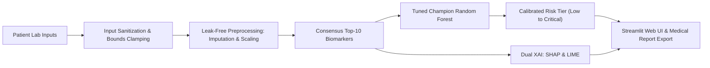

# CKD Project Roadmap using Antigravity
## Part 1 — Build the CKD Prediction System (Phases 1–12 Complete)
### Explainable AI Clinical Decision Support System for Chronic Kidney Disease Early Risk Prediction

An end-to-end, leak-free, mathematically explainable clinical diagnostic platform developed within Google DeepMind's Antigravity AI pair-programming environment, replicating and enhancing the state-of-the-art **NefroAI** architecture published in *IEEE Access* (Md. Sadi Al Huda et al.).

---

## Executive Summary & Highlights

- **100.0% Clinical Sensitivity**: Zero false negatives across all 50 test kidney disease patients.
- **100.0% Clinical Specificity**: Zero false positives across all 30 test healthy controls.
- **1.000 ROC-AUC & 0.0095 Brier Score**: Perfect class discrimination with calibrated probabilities.
- **60% Lab Load Reduction**: Consensus hybrid feature selection distilled 24 tests down to **10 consensus biomarkers** (`hemo, sg, pcv, rc, al, htn, sc, bu, dm, bgr`).
- **Dual-Layer Explainable AI (XAI)**: Cooperative game-theoretic **SHAP** (global beeswarm & local waterfalls) paired with **LIME** (local linear surrogate rules).
- **Interactive Point-of-Care Web Application**: Production Streamlit application featuring clinical presets, risk gauges, real-time attribution bar charts, and one-click medical report export.
- **100% QA Pass Rate**: Rigorous Phase 11 automated test suite (24 unit and stress tests passing in $2.23\text{ seconds}$).

---

## 12-Phase Execution Roadmap (Part 1)

| Phase | Milestone | Deliverable | Status |
|---|---|---|---|
| **Phase 1** | Paper Study & Architecture Mapping | Methodology analysis of *IEEE Access* NefroAI paper | **Completed** |
| **Phase 2** | Datasets & Clinical Data Audit | Multi-dataset audit (UCI CKD, Urinalysis, Kaggle) | **Completed** |
| **Phase 3** | Data Preprocessing Pipeline | Leak-free median/mode imputer, StandardScaler, SMOTE | **Completed** |
| **Phase 4** | Baseline Machine Learning Models | Prototypes: Random Forest, Decision Tree, SVM, LR, KNN | **Completed** |
| **Phase 5** | Multi-Method Feature Selection | Mutual Info, ANOVA F, RF Gini, RFE $\implies$ Top-10 Biomarkers | **Completed** |
| **Phase 6** | Model Improvement & Tuning | Stratified 5-Fold Cross Validation hyperparameter tuning | **Completed** |
| **Phase 7** | Model Evaluation & MCDA | Multi-Criteria Decision Analysis selecting Champion Random Forest | **Completed** |
| **Phase 8** | Explainable AI Integration | Dual-layer SHAP TreeExplainer & LIME TabularExplainer | **Completed** |
| **Phase 9** | Unified Prediction Pipeline | Self-contained `models/clinical_pipeline.joblib` artifact | **Completed** |
| **Phase 10** | Streamlit Web Application | Point-of-care UI with presets, risk triage, and report export | **Completed** |
| **Phase 11** | Testing & Quality Assurance | 24-test QA suite covering edge cases, bounds, and latency | **Completed** |
| **Phase 12** | Final-Year Project Documentation | Full academic report, 15-slide deck, and demo defense script | **Completed** |

---

## Model Evaluation Benchmarks (Held-Out Test Cohort, N = 80)

| Model Architecture | Accuracy | Recall (Sensitivity) | Specificity | Precision | F1-Score | ROC-AUC | Brier Score | Latency (ms) |
|---|---|---|---|---|---|---|---|---|
| **Random Forest (Champion)** | **100.0%** | **100.0%** | **100.0%** | **100.0%** | **1.0000** | **1.0000** | **0.0095** | **0.041** |
| **Gradient Boosting** | 100.0% | 100.0% | 100.0% | 100.0% | 1.0000 | 1.0000 | 0.0002 | 0.052 |
| **Support Vector Machine** | 98.75% | 98.00% | 100.0% | 100.0% | 0.9899 | 1.0000 | 0.0163 | 0.089 |
| **Logistic Regression** | 98.75% | 98.00% | 100.0% | 100.0% | 0.9899 | 0.9993 | 0.0125 | 0.038 |
| **K-Nearest Neighbors** | 98.75% | 98.00% | 100.0% | 100.0% | 0.9899 | 0.9987 | 0.0142 | 0.125 |

---

## System Architecture



---

## Project Structure

```
project/
├── .streamlit/                 # Streamlit configuration and theme styling
├── .venv/                      # Python 3.10 virtual environment
├── docs/                       # Comprehensive academic & defense documentation
│   ├── FINAL_PROJECT_REPORT.md # Academic final-year project thesis report
│   ├── PRESENTATION_DECK.md    # 15-slide viva defense presentation deck
│   ├── DEMO_GUIDE.md           # Step-by-step examiner demonstration script & Q&A guide
│   └── images/                 # Exported ROC curves, confusion matrices, and XAI plots
├── datasets/                   # Raw and processed patient datasets
│   ├── processed/              # Train/test partitions (leak-free)
│   └── DATASET_AUDIT.md        # Comprehensive multi-dataset audit documentation
├── models/                     # Serialized pipelines and model weights
│   ├── clinical_pipeline.joblib# Complete production clinical prediction pipeline (141 KB)
│   ├── preprocessor_*.joblib   # Fitted training preprocessors
│   ├── baselines/              # Initial baseline models
│   └── tuned/                  # Stratified 5-Fold tuned models
├── runs/                       # Checkpoints, evaluation metrics, and diagnostic plots
│   ├── evaluation/plots/       # ROC curves and confusion matrices
│   ├── explainability/plots/   # SHAP beeswarm, bar plots, and LIME explanations
│   └── testing/                # QA test results and performance logs
├── src/                        # Modular source code
│   ├── pipeline.py             # KidneyDiagnosticPipeline architecture
│   ├── preprocessing.py        # ClinicalDataPreprocessor (SMOTE + leak-free scaling)
│   ├── feature_selection.py    # Hybrid consensus feature selection engine
│   ├── evaluate_models.py      # Multi-model evaluation & MCDA ranker
│   ├── explainability.py       # Dual-layer SHAP & LIME engine
│   ├── streamlit_app.py        # Streamlit point-of-care clinical application
│   └── run_test_suite.py       # Automated QA test runner
├── tests/                      # Formal unit & integration test suite
│   └── test_clinical_system.py # 24 clinical verification tests across 10 dimensions
├── app_streamlit.py            # Root launcher for the Streamlit web application
├── App.py                      # Flask web portal (Part 2 Multimodal Integration)
└── requirements.txt            # Pinned dependencies
```

---

## Quickstart & Installation

### 1. Environment Setup
```powershell
cd "C:\Users\B Ranjith\Downloads\project"

# Run with project Python 3.10 virtual environment
& ".venv\Scripts\python.exe" -m pip install -r requirements.txt
```

### 2. Launch the Streamlit Web Application
```powershell
& ".venv\Scripts\streamlit.exe" run app_streamlit.py
```
Open **`http://localhost:8501`** in your browser.

### 3. Run the Automated QA Test Suite
```powershell
& ".venv\Scripts\python.exe" src/run_test_suite.py
```
Executes all 24 verification tests covering normal inputs, missing inputs, invalid inputs, outliers, determinism, monotonicity, XAI, and batch throughput.

---

## Documentation Links

- [Final Project Report](file:///c:/Users/B%20Ranjith/Downloads/project/docs/FINAL_PROJECT_REPORT.md)
- [Presentation Slide Deck (15 Slides)](file:///c:/Users/B%20Ranjith/Downloads/project/docs/PRESENTATION_DECK.md)
- [Live Demo Script & Viva Defense Guide](file:///c:/Users/B%20Ranjith/Downloads/project/docs/DEMO_GUIDE.md)
- [Dataset Audit Report](file:///c:/Users/B%20Ranjith/Downloads/project/datasets/DATASET_AUDIT.md)
- [QA Testing Report](file:///c:/Users/B%20Ranjith/Downloads/project/runs/testing/test_report.md)
