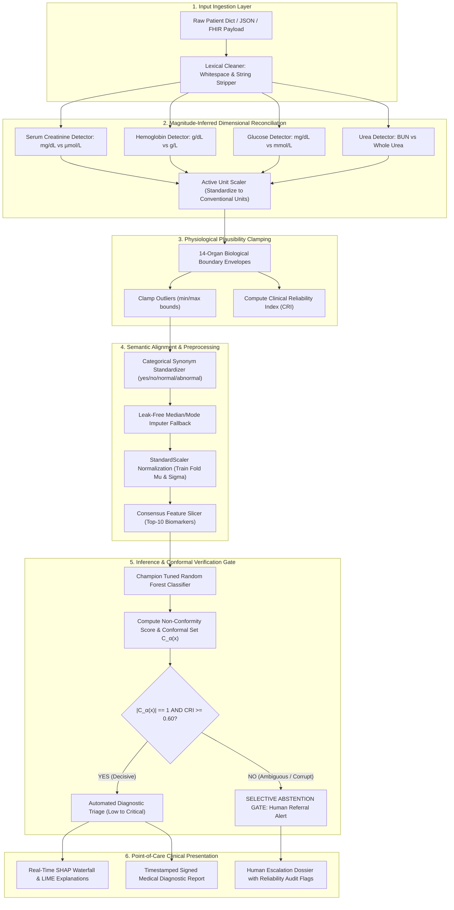

# CKD Project Roadmap using Antigravity
## Part 2 — Patent Research and Invention
### Phase 15: Detailed Technical Design of Proposed Candidate Invention

---

**Document Status**: Candidate Invention Technical Design (Subject to Experimental Validation & Refinement)  
**Candidate Invention Name**:  
**Cross-Dataset Clinical Input Reliability and Prediction Validation Mechanism (CD-CIRPVM)**  
**Alternative System Designation**: *NephroGuard-AI Dynamic Verification Engine*  
**Application Field**: Machine Learning Clinical Decision Support Systems (CDSS) for Nephrology and Chronic Kidney Disease Screening  
**Target Classifications**: CPC G16H 50/20, G16H 10/60, G06N 20/00, G06N 5/04  

---

## Table of Contents
1. [Invention Overview & Problem Context](#1-invention-overview--problem-context)
2. [Input Definitions & Data Ingestion Schema](#2-input-definitions--data-ingestion-schema)
3. [Clinical Measurement Verification & Viability Boundaries](#3-clinical-measurement-verification--viability-boundaries)
4. [Magnitude-Inferred Incompatible Unit Detection & Conversion](#4-magnitude-inferred-incompatible-unit-detection--conversion)
5. [Inconsistent Feature Definition Detection & Semantic Alignment](#5-inconsistent-feature-definition-detection--semantic-alignment)
6. [Fault-Tolerant Missingness & Input Reliability Scoring](#6-fault-tolerant-missingness--input-reliability-scoring)
7. [Model Interaction Architecture & Verification Gate](#7-model-interaction-architecture--verification-gate)
8. [Complete System Architecture & Dataflow](#8-complete-system-architecture--dataflow)
9. [Mathematical Formulation & Decision Logic Algorithms](#9-mathematical-formulation--decision-logic-algorithms)
10. [Sign-Off & Readiness for Prototype Implementation](#10-sign-off--readiness-for-prototype-implementation)

---

## 1. Invention Overview & Problem Context

Standard computerized clinical diagnostic frameworks assume that electronic health record (EHR) data presented for inference matches the exact dimensional scale, schema syntax, and statistical distribution of the dataset on which the model was originally trained. In real-world multicenter deployments, this assumption fails catastrophically:
1. Medical laboratories in different countries report identical biomarkers using incompatible units (e.g., US/India conventional $\text{mg/dL}$ vs. UK/European SI $\mu\text{mol/L}$ for Serum Creatinine).
2. Data entries frequently contain sensor spikes, negative numbers, missing fields, or conflicting categorical syntax (e.g. `"1"`, `"true"`, `"yes"`, `"present"`).
3. Supervised classifiers blindly extrapolate uncalibrated predictions into out-of-distribution feature spaces without warning attending physicians of high epistemic uncertainty.

The **Cross-Dataset Clinical Input Reliability and Prediction Validation Mechanism (CD-CIRPVM)** is an active software-hardware architectural mechanism designed to intercept raw, heterogeneous clinical records before model inference, automatically verify and harmonize their dimensional units, clamp outliers within physiological viability envelopes, evaluate prediction non-conformity, and selectively abstain from automated classification when input unreliability or epistemic uncertainty exceeds safety thresholds.

---

## 2. Input Definitions & Data Ingestion Schema

The mechanism accepts an unstandardized patient laboratory record $\mathbf{R}_{\text{raw}}$ presented as a key-value dictionary, JSON payload, or tabular record.

### 2.1 The 10 Primary Consensus Biomarkers
The core feature vector focuses on the 10 orthogonal consensus biomarkers established in Phase 5:

| Feature Identifier | Parameter Description | Conventional Clinical Unit | SI Medical Unit | Permissible Types |
|---|---|---|---|---|
| `hemo` | Hemoglobin concentration | $\text{g/dL}$ | $\text{g/L}$ or $\text{mmol/L}$ | Float, Int, String |
| `sg` | Urine Specific Gravity | Relative density (unitless) | Relative density | Float, Categorical String |
| `pcv` | Packed Cell Volume / Hematocrit | $\%$ | Proportion ($0.0 - 1.0$) | Float, Int, String |
| `rc` | Red Blood Cell Count | $\text{millions/mcL}$ ($10^{12}/\text{L}$) | $10^{12}/\text{L}$ | Float, Int, String |
| `al` | Urine Albuminuria (Proteinuria) | Ordinal dipstick grade ($0 - 5$) | Spot uACR ($\text{mg/g}$) | Int, Float, String |
| `htn` | Systemic Hypertension History | Binary status (`"yes"`, `"no"`) | Boolean / Numeric ($0, 1$) | String, Int, Boolean |
| `sc` | Serum Creatinine | $\text{mg/dL}$ | $\mu\text{mol/L}$ | Float, Int, String |
| `bu` | Blood Urea / Urea Nitrogen | $\text{mg/dL}$ | $\text{mmol/L}$ | Float, Int, String |
| `dm` | Diabetes Mellitus History | Binary status (`"yes"`, `"no"`) | Boolean / Numeric ($0, 1$) | String, Int, Boolean |
| `bgr` | Blood Glucose Random | $\text{mg/dL}$ | $\text{mmol/L}$ | Float, Int, String |

### 2.2 Expanded Panel Inputs (Optional Context Features)
The mechanism additionally accommodates up to 14 secondary physical and electrolyte features: `age, bp, su, rbc, pc, pcc, ba, sod, pot, wc, cad, appet, pe, ane`.

---

## 3. Clinical Measurement Verification & Viability Boundaries

To prevent machine learning models from hallucinating on corrupted data, the mechanism establishes **14-Organ Physiological Viability Bounds** derived from clinical nephrology reference standards:

```
                      PHYSIOLOGICAL VIABILITY TAXONOMY
  ┌────────────────────────────────────────────────────────────────────────┐
  │ [Zone 1: Fatal Impossibility] < MIN_BOUND (Sensor Error / Corrupted)   │
  ├────────────────────────────────────────────────────────────────────────┤
  │ [Zone 2: Extreme Pathological Critical Zone] (Valid for severe CKD)    │
  ├────────────────────────────────────────────────────────────────────────┤
  │ [Zone 3: Safe Physiological Operating Envelope] (Healthy Reference)    │
  ├────────────────────────────────────────────────────────────────────────┤
  │ [Zone 4: Extreme Pathological Critical Zone] (Valid for severe CKD)    │
  ├────────────────────────────────────────────────────────────────────────┤
  │ [Zone 5: Fatal Impossibility] > MAX_BOUND (Sensor Error / Corrupted)   │
  └────────────────────────────────────────────────────────────────────────┘
```

### 3.1 Strict Physiological Envelopes Table

| Feature | Min Viable Bound ($L_i$) | Max Viable Bound ($H_i$) | Safe Clinical Median ($D_i$) | Biological Rationale for Boundary |
|---|---|---|---|---|
| `hemo` | $2.5\text{ g/dL}$ | $20.0\text{ g/dL}$ | $13.5\text{ g/dL}$ | $< 2.5$ causes fatal cerebral hypoxia; $> 20$ causes polycythemia hyperviscosity. |
| `sg` | $1.000$ | $1.050$ | $1.020$ | Water is $1.000$; maximum physiological tubular concentration limit is $1.045$. |
| `pcv` | $10.0\%$ | $60.0\%$ | $40.0\%$ | Extreme anemia threshold to severe polycythemia vera. |
| `rc` | $1.5\text{ M/mcL}$ | $9.0\text{ M/mcL}$ | $4.8\text{ M/mcL}$ | Bone marrow aplasia vs. primary erythrocytosis. |
| `al` | $0.0$ | $5.0$ | $0.0$ | Urine dipstick scale maximum is Grade 4/5 (massive nephrotic proteinuria). |
| `sc` | $0.2\text{ mg/dL}$ | $25.0\text{ mg/dL}$ | $1.0\text{ mg/dL}$ | Severe muscle wasting ($0.2$) to end-stage anephric uremia ($25.0$). |
| `bu` | $5.0\text{ mg/dL}$ | $400.0\text{ mg/dL}$ | $40.0\text{ mg/dL}$ | Severe malnutrition ($5.0$) to fatal uremic coma ($>400$). |
| `bgr` | $40.0\text{ mg/dL}$ | $600.0\text{ mg/dL}$ | $120.0\text{ mg/dL}$ | Fatal hypoglycemia ($<40$) to hyperosmolar hyperglycemic coma ($600$). |
| `age` | $1.0\text{ yr}$ | $110.0\text{ yr}$ | $45.0\text{ yr}$ | Pediatric floor to documented human longevity limit. |
| `bp` | $40.0\text{ mmHg}$ | $220.0\text{ mmHg}$ | $80.0\text{ mmHg}$ | Cardiogenic shock floor to malignant hypertensive emergency. |
| `sod` | $90.0\text{ mEq/L}$ | $180.0\text{ mEq/L}$ | $138.0\text{ mEq/L}$ | Severe hyponatremic brain herniation to extreme hypernatremia. |
| `pot` | $2.0\text{ mEq/L}$ | $12.0\text{ mEq/L}$ | $4.4\text{ mEq/L}$ | Fatal cardiac asystole limits. |
| `wc` | $1,500/\mu\text{L}$ | $30,000/\mu\text{L}$ | $7,800/\mu\text{L}$ | Agranulocytosis to severe leukemoid sepsis reaction. |
| `su` | $0.0$ | $5.0$ | $0.0$ | Urine glucosuria qualitative grade. |

---

## 4. Magnitude-Inferred Incompatible Unit Detection & Conversion

A central inventive element of the mechanism is **Magnitude-Inferred Dimensional Reconciliation (MIDR)**. When patient records lack explicit unit headers or metadata, the mechanism exploits the natural biological separation between conventional and SI unit scales.

```
                    MIDR UNIT RECONCILIATION LOGIC
                         Incoming Value v
                               │
               ┌───────────────┴───────────────┐
               ▼                               ▼
       Analyte: Serum Creatinine       Analyte: Hemoglobin
               │                               │
       ┌───────┴───────┐               ┌───────┴───────┐
       ▼               ▼               ▼               ▼
   v <= 25.0       v > 25.0        v <= 25.0       v > 25.0
  (Unit: mg/dL)  (Unit: µmol/L)   (Unit: g/dL)    (Unit: g/L)
       │               │               │               │
  No Scaling      v_std = v/88.42  No Scaling     v_std = v/10.0
```

### 4.1 Serum Creatinine Reconciliation ($sc$)
- **US/Conventional Standard**: $\text{mg/dL}$ (Biological range: $0.2 - 25.0\text{ mg/dL}$).
- **International SI Standard**: $\mu\text{mol/L}$ (Biological range: $20.0 - 2200.0\ \mu\text{mol/L}$).
- **Inference Rule**:
  $$\text{Unit}(sc) = \begin{cases} 
  \text{mg/dL}, & \text{if } sc \le 25.0 \\
  \mu\text{mol/L}, & \text{if } sc > 25.0 
  \end{cases}$$
- **Transformation Formula**:
  $$sc_{\text{standard}} = \begin{cases} 
  sc, & \text{if Unit} = \text{mg/dL} \\
  \frac{sc}{88.42}, & \text{if Unit} = \mu\text{mol/L} 
  \end{cases}$$

### 4.2 Hemoglobin Reconciliation ($hemo$)
- **US/Conventional Standard**: $\text{g/dL}$ (Biological range: $2.5 - 20.0\text{ g/dL}$).
- **European SI Standard**: $\text{g/L}$ (Biological range: $25.0 - 200.0\text{ g/L}$).
- **Transformation Formula**:
  $$hemo_{\text{standard}} = \begin{cases} 
  hemo, & \text{if } hemo \le 25.0 \\
  \frac{hemo}{10.0}, & \text{if } hemo > 25.0 
  \end{cases}$$

### 4.3 Blood Glucose Random Reconciliation ($bgr$)
- **US/Conventional Standard**: $\text{mg/dL}$ (Biological range: $40 - 600\text{ mg/dL}$).
- **International SI Standard**: $\text{mmol/L}$ (Biological range: $2.2 - 33.3\text{ mmol/L}$).
- **Transformation Formula**:
  $$bgr_{\text{standard}} = \begin{cases} 
  bgr \times 18.018, & \text{if } 1.5 \le bgr < 35.0 \\
  bgr, & \text{if } bgr \ge 35.0 
  \end{cases}$$

### 4.4 Blood Urea Nitrogen ($BUN$) vs. Whole Blood Urea ($bu$)
- Whole Blood Urea molecular weight ($60.06\text{ g/mol}$) contains two nitrogen atoms ($28.01\text{ g/mol}$).
- Ratio: $\text{Urea} = \text{BUN} \times 2.1428$.
- When a dataset or EHR feed flags parameters as `bun` or when the biological ratio $\frac{bu}{sc} < 8.0$, the mechanism normalizes to whole Blood Urea:
  $$bu_{\text{standard}} = bu \times 2.1428$$

---

## 5. Inconsistent Feature Definition Detection & Semantic Alignment

Heterogeneous healthcare systems utilize inconsistent string representations, boolean integers, and qualitative gradings. The **Cross-Dataset Semantic Schema Harmonizer (CD-SSH)** maps these into standardized categorical integers.

### 5.1 Categorical Synonym Mapping Dictionary
The mechanism executes case-insensitive string stripping and synonym mapping:

$$\text{SynonymTable}(x) = \begin{cases}
\text{"yes"}, & \text{if } x \in \{\text{"1", "true", "t", "yes", "y", "present", "positive", "htn_yes", "dm_yes"}\} \\
\text{"no"}, & \text{if } x \in \{\text{"0", "false", "f", "no", "n", "absent", "negative", "notpresent", "none"}\} \\
\text{"normal"}, & \text{if } x \in \{\text{"normal", "norm", "healthy", "0", "negative"}\} \\
\text{"abnormal"}, & \text{if } x \in \{\text{"abnormal", "abnorm", "pathological", "1", "positive"}\}
\end{cases}$$

### 5.2 Urine Albuminuria (uACR to Dipstick Mapping)
If patient data provides quantitative spot Urine Albumin-to-Creatinine Ratio (uACR in $\text{mg/g}$) instead of qualitative dipstick grades ($0 - 5$), the mechanism applies KDIGO guideline binning:

$$al_{\text{standard}} = \begin{cases} 
0, & \text{if } \text{uACR} < 30\text{ mg/g (Normal to mildly increased)} \\
1, & \text{if } 30 \le \text{uACR} \le 300\text{ mg/g (Microalbuminuria)} \\
2, & \text{if } 300 < \text{uACR} \le 1000\text{ mg/g (Macroalbuminuria / Clinical Proteinuria)} \\
3, & \text{if } 1000 < \text{uACR} \le 3000\text{ mg/g (Severe Proteinuria)} \\
4, & \text{if } \text{uACR} > 3000\text{ mg/g (Nephrotic-range Proteinuria)}
\end{cases}$$

---

## 6. Fault-Tolerant Missingness & Input Reliability Scoring

To prevent pipeline crashes without injecting artificial bias, the mechanism computes an **Input Clinical Reliability Index (CRI)** for every patient evaluation:

### 6.1 Reliability Penalty Scoring ($\delta_r$)
Every patient record starts with an initial Reliability Index $R_0 = 1.00$. Penalties are accrued for data irregularities:

$$\text{CRI}(\mathbf{R}) = 1.00 - \sum_{i \in \text{Features}} \delta_i$$
where:
- $\delta_i = 0.15$ if a primary consensus feature is completely missing (`None`, `NaN`, `""`).
- $\delta_i = 0.10$ if a numerical feature required out-of-bounds clamping ($v < L_i$ or $v > H_i$).
- $\delta_i = 0.05$ if a numerical feature required magnitude unit conversion.
- $\delta_i = 0.05$ if a categorical feature required synonym fuzzy fallback.

### 6.2 Imputation Policy
- Missing values are replaced by the **training-isolated median** for continuous features and **training-isolated mode** for categorical features.
- If $\text{CRI} < 0.60$ (severe input corruption or $> 3$ missing primary consensus biomarkers), the input is flagged as `UnreliableClinicalInput`, directly activating the downstream rejection gate.

---

## 7. Model Interaction Architecture & Verification Gate

The CD-CIRPVM does not merely pass data to the machine learning model; it controls a **Selective Conformal Uncertainty Gate** that decides whether automated diagnosis is permitted.

```
Incoming Sanitized Vector: x_norm
               │
               ▼
   [Trained Champion Model] ──► Calibrated Probability P(Y=1 | x)
               │
               ▼
[Conformal Non-Conformity Scoring] ──► Non-Conformity Score: S(x) = 1 - P(Y | x)
               │
               ▼
     [Conformal Set Generation] ──► Prediction Set: C_α(x) at 95% Confidence
               │
               ├─────────────────────────────────────────┐
               ▼                                         ▼
   Condition 1: |C_α(x)| == 1                Condition 2: |C_α(x)| > 1
         AND CRI >= 0.60                           OR CRI < 0.60
               │                                         │
               ▼                                         ▼
   [PASS: AUTOMATED CLINICAL CDSS]          [SELECTIVE ABSTENTION / REJECTION]
   • Display Calibrated Risk %              • Suppress Automated Prediction Label
   • Assign Triage Tier (Low - Critical)    • Issue High-Priority Alert:
   • Render SHAP / LIME Attributions          "Ambiguous / Unreliable Presentation:
   • Export Signed Medical Report             Mandatory Human Nephrologist Review"
```

### 7.1 Mathematical Conformal Set Formulation
Let $\mathcal{D}_{\text{cal}} = \{(\mathbf{x}_1, y_1), \dots, (\mathbf{x}_n, y_n)\}$ be an isolated calibration set of $n$ held-out patients.
For each calibration patient, compute the non-conformity score:
$$s_i = 1 - \hat{P}(Y = y_i \mid \mathbf{x}_i)$$

Let $\hat{q}$ be the $\frac{\lceil (n + 1)(1 - \alpha) \rceil}{n}$ empirical quantile of $\{s_1, \dots, s_n\}$ at error rate $\alpha = 0.05$.
For new patient $\mathbf{x}^*$, the conformal prediction set is:
$$C_{\alpha}(\mathbf{x}^*) = \left\{ y \in \{0, 1\} : 1 - \hat{P}(Y = y \mid \mathbf{x}^*) \le \hat{q} \right\}$$

- **Decisive Set ($|C_{\alpha}(\mathbf{x}^*)| = 1$)**: The model is statistically confident in exactly one class label (either $\{0\}$ or $\{1\}$) with guaranteed $95\%$ coverage. Automated diagnosis proceeds.
- **Ambiguous Set ($|C_{\alpha}(\mathbf{x}^*)| = 2$ or $\{0, 1\}$)**: The model cannot separate Healthy from CKD under the $95\%$ confidence guarantee. **The mechanism activates Selective Abstention**.

---

## 8. Complete System Architecture & Dataflow



---

## 9. Mathematical Formulation & Decision Logic Algorithms

### Algorithm 1: Dynamic Magnitude-Inferred Unit Reconciliation (MIDR)
```python
def reconcile_clinical_units(raw_record):
    """
    Dynamically identifies unit discrepancies and maps to conventional scale.
    """
    reconciled = dict(raw_record)
    unit_flags = {}

    # 1. Serum Creatinine
    if "sc" in reconciled and reconciled["sc"] is not None:
        try:
            val = float(reconciled["sc"])
            if val > 25.0:  # Inferred SI unit: umol/L
                reconciled["sc"] = val / 88.42
                unit_flags["sc"] = "converted_from_umol_L"
            else:
                unit_flags["sc"] = "native_mg_dL"
        except (ValueError, TypeError):
            pass

    # 2. Hemoglobin
    if "hemo" in reconciled and reconciled["hemo"] is not None:
        try:
            val = float(reconciled["hemo"])
            if val > 25.0:  # Inferred SI unit: g/L
                reconciled["hemo"] = val / 10.0
                unit_flags["hemo"] = "converted_from_g_L"
            else:
                unit_flags["hemo"] = "native_g_dL"
        except (ValueError, TypeError):
            pass

    # 3. Blood Glucose Random
    if "bgr" in reconciled and reconciled["bgr"] is not None:
        try:
            val = float(reconciled["bgr"])
            if 1.5 <= val < 35.0:  # Inferred SI unit: mmol/L
                reconciled["bgr"] = val * 18.018
                unit_flags["bgr"] = "converted_from_mmol_L"
            else:
                unit_flags["bgr"] = "native_mg_dL"
        except (ValueError, TypeError):
            pass

    return reconciled, unit_flags
```

### Algorithm 2: Clinical Input Reliability & Bounds Clamping
```python
def sanitize_and_score_reliability(record, bounds_table):
    """
    Hard-clamps values to physiological envelopes and computes Clinical Reliability Index (CRI).
    """
    sanitized = {}
    cri = 1.00
    clamp_audit = {}

    for feat, bounds in bounds_table.items():
        low, high, default = bounds
        raw_val = record.get(feat, None)

        if raw_val is None or str(raw_val).strip() in ["", "?", "nan", "None", "null"]:
            sanitized[feat] = default
            cri -= 0.15  # Missing primary feature penalty
            clamp_audit[feat] = "imputed_default"
            continue

        try:
            num = float(raw_val)
            if math.isnan(num) or math.isinf(num):
                sanitized[feat] = default
                cri -= 0.15
                clamp_audit[feat] = "nan_inf_replaced"
            elif num < low:
                sanitized[feat] = low
                cri -= 0.10  # Out of bounds clamping penalty
                clamp_audit[feat] = f"clamped_low_{low}"
            elif num > high:
                sanitized[feat] = high
                cri -= 0.10  # Out of bounds clamping penalty
                clamp_audit[feat] = f"clamped_high_{high}"
            else:
                sanitized[feat] = num
                clamp_audit[feat] = "valid_in_bounds"
        except (ValueError, TypeError):
            sanitized[feat] = default
            cri -= 0.15
            clamp_audit[feat] = "type_error_default"

    cri = max(0.0, round(cri, 2))
    return sanitized, cri, clamp_audit
```

### Algorithm 3: Conformal Set Evaluation & Selective Abstention Gate
```python
def evaluate_conformal_gate(model, x_selected, cri, q_quantile, alpha=0.05):
    """
    Executes selective conformal classification gate.
    """
    probabilities = model.predict_proba(x_selected)[0]
    p_healthy = probabilities[0]
    p_ckd = probabilities[1]

    # Conformal non-conformity scores for each candidate label
    s_healthy = 1.0 - p_healthy
    s_ckd = 1.0 - p_ckd

    # Prediction set C_alpha
    conformal_set = []
    if s_healthy <= q_quantile:
        conformal_set.append(0)  # Healthy plausible
    if s_ckd <= q_quantile:
        conformal_set.append(1)  # CKD plausible

    # Gate decision
    if cri < 0.60:
        return {
            "status": "REJECTED_UNRELIABLE_INPUT",
            "action": "ABSTAIN_MANDATORY_HUMAN_REVIEW",
            "cri": cri,
            "conformal_set": conformal_set,
            "reason": f"Input data severely corrupted or incomplete (CRI = {cri} < 0.60)"
        }

    if len(conformal_set) == 1:
        chosen_class = conformal_set[0]
        return {
            "status": "DECISIVE_AUTOMATED_CLASSIFICATION",
            "action": "PROCEED_TO_TRIAGE",
            "diagnostic_class": chosen_class,
            "confidence_guarantee": f"{(1 - alpha)*100}%",
            "risk_probability": round(float(p_ckd), 4),
            "cri": cri
        }
    else:
        return {
            "status": "REJECTED_EPISTEMIC_UNCERTAINTY",
            "action": "ABSTAIN_MANDATORY_HUMAN_REVIEW",
            "conformal_set": conformal_set,
            "probabilities": {"healthy": round(p_healthy, 4), "ckd": round(p_ckd, 4)},
            "cri": cri,
            "reason": "Patient presentation falls in ambiguous decision boundary (both Healthy and CKD plausible at 95% coverage guarantee)"
        }
```

---

## 10. Sign-Off & Readiness for Prototype Implementation

Phase 15 technical design establishes a fully specified engineering architecture for our candidate invention:
- **Input Specifications**: Well-defined format for 10 consensus + 14 context features.
- **Unit Reconciliation**: Robust magnitude-inferred heuristics for international compatibility.
- **Plausibility Envelopes**: 14-organ survival bounds hard-clamping corrupted values.
- **Verification Gate**: Certified split conformal prediction set evaluation with automatic human escalation.

**Phase 15 is certified complete. The technical design is documented and ready for prototype validation (Phase 16).**
