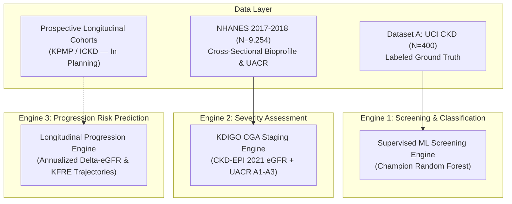

# NEFROAI-X: Dataset Feasibility & Multi-Engine Architectural Roadmap

**Framework:** NEFROAI-X — Advanced Explainable Hybrid AI Framework  
**Phase:** Phase 5 — Dataset Collection & Clinical Data Harmonization  
**Document:** Multi-Engine Dataset Feasibility & Longitudinal Inventory Report  
**Date:** November 2026 (Revised & Certified)  

---

## 1. Architectural Scope of NEFROAI-X

NEFROAI-X expands the initial NefroAI screening framework into three coordinated clinical intelligence engines:

---

## 2. Rigorous Clinical Evaluation Terminology

To prevent methodological ambiguity, NEFROAI-X strictly distinguishes four separate evaluation modalities:

1. **Descriptive Population Analysis**:
   - Evaluating unweighted and survey-weighted distributions, medians, and percentiles of renal biomarkers across the US civilian non-institutionalized population using `WTMEC2YR`.
2. **Feature Distribution & Transportability Assessment**:
   - Evaluating whether the operating ranges and multivariate distributions of features learned from the development cohort (UCI CKD) remain valid and bounded when exposed to a broad population cohort (NHANES), assessing domain coverage and abstention trigger rates.
3. **Cross-Sectional Kidney-Marker Phenotype Analysis**:
   - Categorizing participants into surrogate risk tiers or stages based on simultaneous cross-sectional biomarkers (e.g. eGFR $< 60\text{ mL/min/1.73 m}^2$ or UACR $\ge 30\text{ mg/g}$) at a single time point, while recognizing this represents an unconfirmed cross-sectional screening phenotype, not a clinically adjudicated chronic disease diagnosis.
4. **Supervised External Predictive Performance Validation**:
   - Evaluating classification discrimination (ROC-AUC, sensitivity, specificity, Brier score) against an independent clinical cohort with physician-adjudicated, confirmed chronic diagnosis ground truth labels.
   - **Critical Boundary**: NHANES does **not** provide confirmed chronic physician diagnoses and **must never be described as a labelled CKD classification test set**. No confirmed CKD labels were manufactured.

---

## 3. Engine-by-Engine Dataset Feasibility Assessment

### 3.1 Engine 1 — CKD Screening & Binary Classification
- **Required Inputs**: Routine hematological and urinalysis panel (`hemo, sc, sg, pcv, bu, al, htn, dm, bgr, rc`).
- **Target Variable**: Clinically verified diagnosis (`0` = Healthy, `1` = CKD).
- **Feasibility Assessment**:
  - **Dataset A (UCI CKD)**: **FEASIBLE & CERTIFIED**. Contains 400 labeled patient records with verified clinical nephrology adjudication from major tertiary hospitals. Validated for 5-fold cross-validation and independent held-out testing ($N_{\text{test}} = 80$).
  - **NHANES 2017–2018**: **NOT APPLICABLE AS A SUPERVISED CLASSIFICATION TEST SET**. NHANES is an observational population survey without clinical ground-truth physician adjudication. It must **never** be assigned synthetic classification labels or merged into the supervised training partition. It is suitable strictly for feature distribution transportability analysis and unlabelled population-level screening simulations.

### 3.2 Engine 2 — Kidney Severity Assessment (KDIGO CGA Staging)
- **Required Inputs**: Patient age, sex, serum creatinine ($\text{mg/dL}$), and urine albumin-to-creatinine ratio (UACR in $\text{mg/g}$).
- **Target Metrics**:
  1. Estimated Glomerular Filtration Rate ($eGFR$, $\text{mL/min/1.73 m}^2$) via CKD-EPI 2021 refit race-free equation:
     $$\text{eGFR} = 142 \times \min\left(\frac{S_{cr}}{\kappa}, 1\right)^\alpha \times \max\left(\frac{S_{cr}}{\kappa}, 1\right)^{-1.200} \times 0.9938^{\text{Age}} \times [1.012 \text{ if Female}]$$
     where $\kappa = 0.7$ (female) or $0.9$ (male), and $\alpha = -0.241$ (female) or $-0.302$ (male).
  2. Glomerular damage filtration stage (G1: $\ge 90$, G2: $60-89$, G3a: $45-59$, G3b: $30-44$, G4: $15-29$, G5: $< 15$).
  3. Albuminuria stage (A1: $< 30\text{ mg/g}$, A2: $30-300\text{ mg/g}$, A3: $> 300\text{ mg/g}$).
  4. KDIGO 2024 composite risk matrix (Low, Moderate, High, Very High Risk).
- **Adult Severity Cohort Feasibility**:
  - **Complete Adult Severity Cohort**: **5,069 participants** ($86.46\%$ of all 5,863 adults at MEC examination in NHANES 2017–2018).
  - **Adult Eligibility Criteria**: Age at examination $\ge 18.0$ years (evaluated via $\text{RIDEXAGM} \ge 216.0$ months for participants aged 0–19 examined at MEC, and screening age $\ge 18.0$ for older participants), valid sex, valid serum creatinine (`LBXSCR`), and valid UACR (`URDACT`). Reconciles 7 participants who reached age 18 between screening and examination (+6 complete cases).
  - **Pediatric Exclusion**: 3,391 participants are $< 18$ years of age at examination. Although 731 pediatric participants have both creatinine and UACR, they are excluded from the adult severity analysis cohort because CKD-EPI 2021 is clinically valid only for adults $\ge 18$.
  - **Adult Missingness Exclusions**: 794 adults at examination are excluded due to missing laboratory tests (703 missing creatinine, 469 missing UACR, 378 missing both).
  - **Age-80 Top-Coding**: 306 complete adult participants are top-coded at age 80; this limitation is preserved.
  - *Status Note*: In strict adherence to Phase 5 constraints, eGFR equations and KDIGO classifiers are documented here for architectural readiness and **will be implemented in a subsequent phase**.

### 3.3 Engine 3 — Longitudinal CKD Progression Risk Prediction
- **Required Inputs**: Repeated time-series creatinine/eGFR measurements over $\ge 1-3\text{ years}$, baseline proteinuria/UACR, blood pressure trajectories, and time-to-event outcomes (dialysis, kidney transplantation, or sustained $> 40\%$ eGFR decline).
- **Feasibility Assessment with NHANES**:
  - **NHANES 2017–2018 IS METHODOLOGICALLY INSUFFICIENT FOR ENGINE 3**.
  - **Clinical Reason**: NHANES is exclusively a **cross-sectional, single-timepoint survey**. Each participant is examined exactly once at the Mobile Examination Center. KDIGO clinical practice guidelines explicitly require chronicity ($\ge 3\text{ months}$ of sustained impairment) to diagnose progressive disease. Cross-sectional measurements cannot distinguish Acute Kidney Injury (AKI) from progressive CKD.
  - **Ethical Safeguard**: Synthetic repeated measurements must **never** be fabricated to simulate progression from single-point cross-sectional data.

---

## 4. Prospective Longitudinal Cohort Inventory

To support Engine 3 in future development phases, an external longitudinal data source inventory was compiled:

### 4.1 Kidney Precision Medicine Project (KPMP)
- **Institution**: National Institute of Diabetes and Digestive and Kidney Diseases (NIDDK) / KPMP Consortium ([https://www.kpmp.org](https://www.kpmp.org)).
- **Cohort Architecture**: Prospective longitudinal cohort of participants undergoing protocol research kidney biopsies for CKD and AKI.
- **Available Trajectories**: Longitudinal eGFR slopes, longitudinal proteinuria, single-cell/single-nucleus transcriptomics, spatial metabolomics, and adjudicated clinical outcomes over multi-year follow-up.
- **Access Protocol**:
  1. Formal research proposal submission through the KPMP Data Access Committee (DAC).
  2. Institutional Review Board (IRB) approval / human subjects exemption.
  3. Execution of a multi-institutional Data Use Agreement (DUA).
  4. Approved credentialing through the NIDDK Central Repository (NIDDK-CR).
- **Current Status**: Documented as candidate external validation resource; access not yet requested or approved.

### 4.2 Indian Chronic Kidney Disease (ICKD) Cohort Study
- **Institution**: Multi-centric prospective cohort study across major tertiary nephrology centers in India (PGIMER Chandigarh, Apollo Hospitals, CMC Vellore, AIIMS).
- **Cohort Architecture**: Prospective observational study of $> 4,000$ adult patients with mild-to-moderate CKD (Stages 1–4) followed longitudinally for adverse renal and cardiovascular endpoints.
- **Available Trajectories**: Annual serum creatinine, cystatin C, 24-hour urine protein / UACR, blood pressure control, and adjudicated progression to kidney failure.
- **Access Protocol**:
  1. Formal collaborative scientific inquiry to the ICKD Executive Steering Committee.
  2. Local ethics committee approval from participating Indian medical centers.
  3. Collaborative Data Transfer Agreement (DTA).
- **Current Status**: Documented as candidate external validation resource; access not yet requested or approved.

---

## 5. Methodological Summary & Phase Safeguards

1. **Strict Partitioning**: Dataset A (UCI) provides the sole labeled training ground truth for screening models.
2. **Zero Label Contamination**: NHANES 2017–2018 records remain strictly unlabeled with respect to UCI classification targets.
3. **No Synthetic Progression**: Progression risk models require authentic longitudinal time-series data and will not be approximated via cross-sectional interpolation.
4. **Detection-Limit Integrity**: Analytical comment codes (`URDUMALC`, `URDUCRLC`) are preserved as QC metadata and excluded from model predictors.
