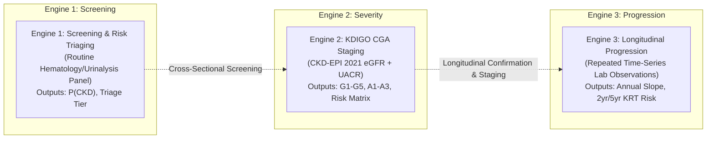
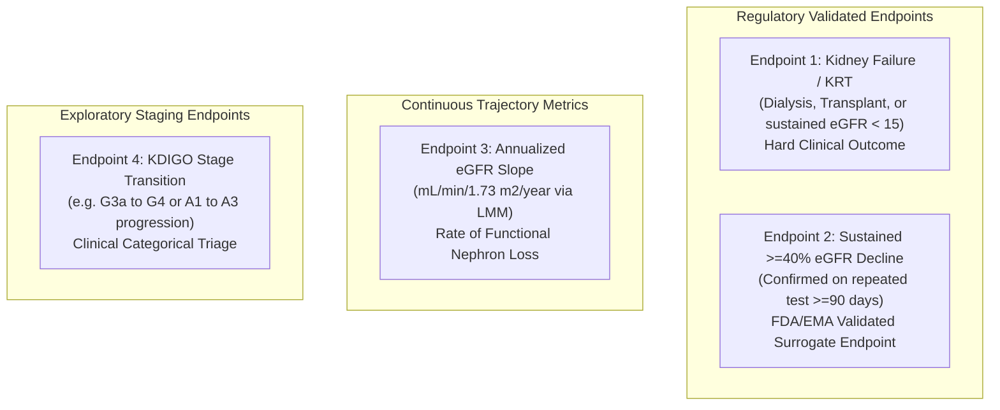
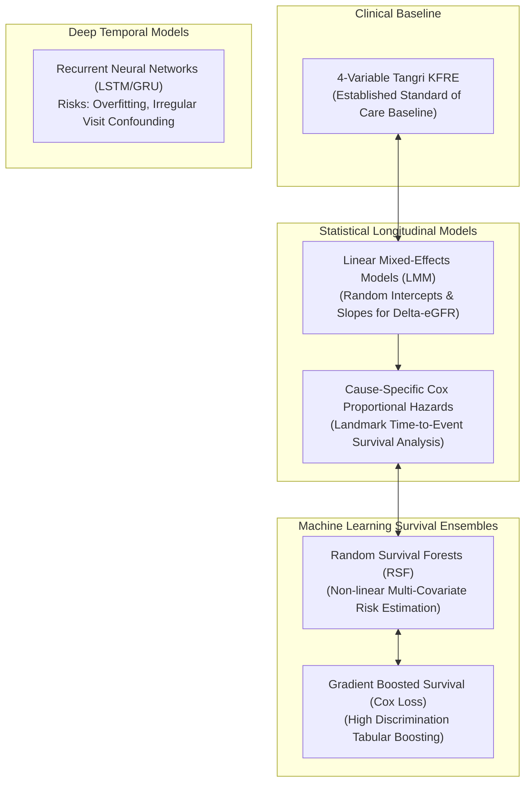
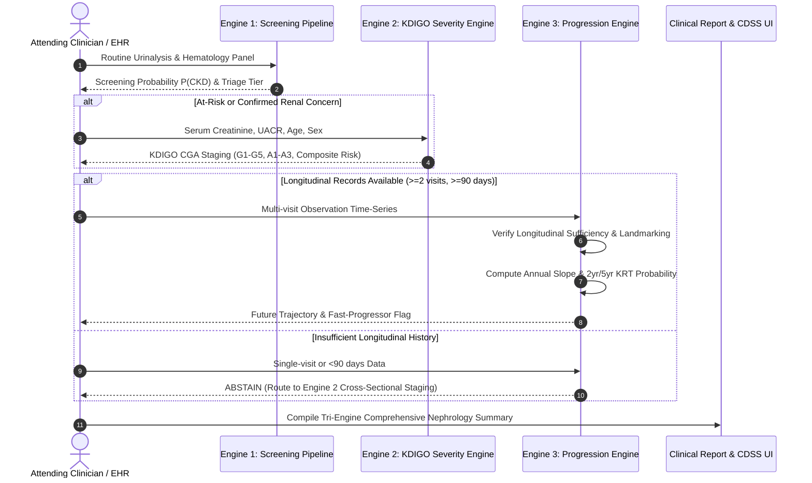
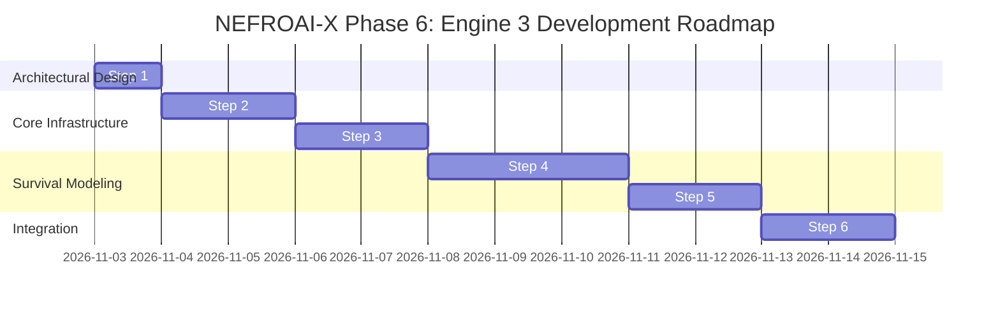

# NEFROAI-X: Longitudinal Dataset Feasibility & Engine 3 Architecture Specification

**Framework:** NEFROAI-X — Advanced Explainable Hybrid AI Framework for Kidney Disease  
**Phase:** Phase 6 — Engine 3 Development (Longitudinal Progression Risk Prediction)  
**Document:** Step 1 — Longitudinal Dataset Feasibility & Architecture Specification  
**Issuing Authority:** Senior Clinical Data Scientist, Nephrology AI Researcher & ML Architect  
**Publication Date:** November 2026  
**Status:** Certified Architecture & Implementation Roadmap  
**Repository State:** `main` (`64b831a`)  

---

## 1. Executive Summary & Clinical Mission

The NEFROAI-X framework is an investigational Clinical Decision Support System (CDSS) for kidney disease. While Engine 1 provides non-invasive screening from routine laboratory biomarkers and Engine 2 establishes cross-sectional disease severity via KDIGO CGA (Cause, GFR, Albuminuria) staging, neither cross-sectional engine can predict an individual patient's **future trajectory**.

**Engine 3** is dedicated to **Longitudinal Kidney Disease Progression Risk Prediction**. Its clinical mission is to:
1. Estimate the annualized rate of renal filtration loss ($\text{eGFR slope}$ in $\text{mL/min/1.73 m}^2/\text{year}$).
2. Forecast the discrete $2\text{-year}$ and $5\text{-year}$ probabilities of experiencing a **sustained $\ge 40\%$ decline in eGFR** or progressing to **Kidney Failure / Kidney Replacement Therapy (KRT / ESKD)**.
3. Provide patient-specific trajectory explainability, distinguishing indolent from rapidly progressive nephropathies.
4. Enforce strict clinical safety boundaries: selectively abstaining when longitudinal data are insufficient to establish a true chronic trajectory.



---

## 2. Review of Existing System Architecture

A rigorous audit of the current codebase confirms that Engine 3 will interface cleanly with existing components without modifying certified baselines:

| System Component | File Path | Current Status | Integration Role with Engine 3 |
|---|---|:---:|---|
| **Engine 1 Pipeline** | `src/pipeline.py` | Production Champion (RF) | Upstream screening filter; identifies at-risk patients who require longitudinal monitoring. |
| **Engine 2 Severity** | `src/engines/kidney_severity_engine.py` | Production Engine | Provides baseline and landmark KDIGO CGA staging ($G$ and $A$ categories) as foundational baseline covariates for Engine 3. |
| **eGFR Calculation** | `src/clinical/egfr_calculator.py` | CKD-EPI 2021 Race-Free | Computes race-free eGFR for every repeated observation in the longitudinal sequence. |
| **KDIGO Staging** | `src/clinical/kdigo_staging.py` | KDIGO 2012/2024 CGA | Determines stage transitions (e.g. progression from G3a to G4). |
| **Reliability Mechanism**| `src/clinical_input_reliability_mechanism.py` | Standalone Prototype | Provides MIDR unit conversion and Clinical Reliability Index (CRI) for time-series observations. |
| **NHANES Ingestion** | `src/data_sources/nhanes_loader.py` | Production Loader | Cross-sectional population benchmark; **excluded from Engine 3 progression training**. |

> [!IMPORTANT]
> **Methodological Boundary on NHANES 2017–2018**:
> As certified in Phase 5, NHANES is exclusively a **cross-sectional, single-timepoint population survey**. Each participant has at most one laboratory examination. Under KDIGO clinical guidelines, chronicity requires documented structural or functional impairment persisting for $\ge 3\text{ months}$. Cross-sectional data cannot establish progression slopes or distinguish Acute Kidney Injury (AKI) from progressive CKD. **Engine 3 will not manufacture pseudo-longitudinal records from NHANES.**

---

## 3. Longitudinal Dataset Feasibility Analysis

Progression modeling requires multi-year patient follow-up with repeated laboratory measurements and adjudicated clinical outcomes. The following primary external candidate cohorts were evaluated:

### 3.1 Detailed Cohort Comparison Matrix

| Evaluation Dimension | CRIC (Chronic Renal Insufficiency Cohort) | KPMP (Kidney Precision Medicine Project) | ICKD (Indian CKD Cohort Study) | AASK / MDRD (Historical Clinical Trials) | Continuous NHANES (2017–2018) |
|---|---|---|---|---|:---:|
| **Sponsoring Body** | NIH / NIDDK | NIH / NIDDK Consortium | Indian Steering Committee (ICMR) | NIH / NIDDK | CDC / NCHS |
| **Study Design** | Prospective observational multi-center cohort | Prospective observational biopsy cohort | Prospective observational multi-center cohort | Randomized controlled trials with extended cohorts | Continuous population cross-sectional survey |
| **Sample Size ($N$)** | $> 5,400$ adult CKD patients (Phases 1–3) | $\sim 500 - 1,200$ protocol research biopsies | $> 4,000$ adult CKD patients (Stages 1–4) | $\sim 1,094$ (AASK), $\sim 840$ (MDRD) | $9,254$ participants ($5,069$ adult severity cases) |
| **Follow-up Duration** | Up to $15 - 20\text{ years}$ (median $\sim 8\text{ years}$) | $1 - 5\text{ years}$ (prospective ongoing) | $3 - 5\text{ years}$ (ongoing) | $3 - 12\text{ years}$ | **Zero** ($1$ examination per person) |
| **Repeated eGFR** | Annual visits (serum creatinine & cystatin C) | Quarterly to annual clinic visits | 6-month to annual visits | Monthly to bi-monthly trial visits | **None** ($1$ measurement only) |
| **Repeated UACR** | Annual spot UACR + 24-hr urine protein | Longitudinal UACR and urine proteomics | Annual spot UACR / 24-hr protein | 24-hour urine protein / UACR | **None** ($1$ measurement only) |
| **Longitudinal IDs** | Patient Sequence ID (`PID`), Visit ID (`VISIT`) | Participant ID (`Participant_ID`) | Patient MRN/Study ID (`ICKD_ID`) | Randomization ID (`PATID`) | `SEQN` (cross-sectional only) |
| **Primary Endpoints** | Adjudicated ESKD (dialysis/transplant), $\ge 50\%$ eGFR decline, Death | eGFR slope, adjudicated CKD progression, AKI recovery | Adjudicated kidney failure, CV death, doubling of creatinine | Dialysis, transplantation, GFR slope, death | **None** (unadjudicated cross-sectional) |
| **Missingness / Censoring** | Informative right-censoring, competing risk of pre-ESKD death | Low loss to follow-up, ongoing cohort | Loss to follow-up in developing region context | Low trial attrition, protocolized follow-up | Non-response survey weights (`WTMEC2YR`) |
| **Access Pathway** | NIDDK Central Repository (NIDDK-CR) application | KPMP Data Access Committee (DAC) application | Formal DTA with Indian Steering Committee | NIDDK Central Repository (NIDDK-CR) | Public open access (Already harmonized) |
| **Access Restrictions** | DUA, IRB approval, scientific review ($\sim 2-4\text{ months}$) | DUA, DAC approval, IRB protocol ($\sim 3-6\text{ months}$) | Collaborative agreement, local ethics committee | DUA, NIDDK approval ($\sim 1-2\text{ months}$) | Fully public domain |
| **Engine 3 Suitability** | **GOLD STANDARD (RECOMMENDED)** | **HIGH (Molecular & Multi-Omics)** | **HIGH (External Global Validation)** | **MODERATE (Historical treatments)** | **UNSUITABLE (Cross-Sectional Only)** |

---

## 4. Recommended Dataset & Access Strategy

### 4.1 Primary Production Cohort: CRIC (Chronic Renal Insufficiency Cohort)
CRIC is the definitive epidemiological benchmark for CKD progression:
- **Clinical Alignment**: Recruited adult patients with baseline eGFR $20–70\text{ mL/min/1.73 m}^2$, matching the exact target population for CDSS progression triaging.
- **Biomarker Consistency**: Contains standardized enzymatic creatinine, cystatin C, spot UACR, blood pressure, diabetes status, and cardiovascular history.
- **Access Pathway**:
  1. Prepare formal NIDDK Central Repository (NIDDK-CR) data request proposal.
  2. Obtain Institutional Review Board (IRB) review or human-subjects research exemption certification.
  3. Execute NIDDK-CR Data Use Certification (DUC).
  4. Secure authorized data transfer and credentialed storage.

### 4.2 Engineering & Offline Testing Strategy: Validated Clinical Transition Generators
While awaiting institutional DUA approval for raw CRIC microdata, software engineering and pipeline development cannot remain blocked. In strict compliance with regulatory and testing standards:
- **Zero Fabrication Rule**: We will **never** generate fake longitudinal records and pass them off as real clinical data.
- **Calibrated Semi-Markov Simulation**: We will implement a dedicated test fixture generator (`src/data_sources/longitudinal_simulator.py`) strictly for unit testing, CI/CD pipeline verification, and algorithmic stress testing.
- **Calibration Standard**: The generator will be calibrated strictly against published epidemiological transition parameters from the landmark **Kidney Failure Risk Equation (KFRE)** validation meta-analysis (Tangri et al., *JAMA* 2016; $N=721,108$ across 31 global cohorts).

---

## 5. Clinical Progression Endpoint Definitions

To avoid ambiguity, Engine 3 defines four distinct clinical progression targets categorized by regulatory acceptance and clinical utility:



### 5.1 Endpoint 1: Kidney Failure / Kidney Replacement Therapy (KRT / ESKD)
- **Status**: **Hard Clinical Regulatory Endpoint** (Gold Standard).
- **Definition**: Initiation of maintenance chronic dialysis (hemodialysis or peritoneal dialysis) for $\ge 30\text{ days}$, receipt of a kidney transplant, or sustained $\text{eGFR} < 15\text{ mL/min/1.73 m}^2$.
- **Prediction Horizons**: Discrete $2\text{-year}$ ($24\text{ months}$) and $5\text{-year}$ ($60\text{ months}$) cumulative incidence.
- **Competing Risk Handling**: In CKD patients (especially elderly and diabetic cohorts), pre-KRT cardiovascular and all-cause mortality is a major competing event. Engine 3 will incorporate **Cause-Specific Cox** and **Fine-Gray Subdistribution Hazard** models to prevent overestimating kidney failure risk.

### 5.2 Endpoint 2: Sustained $\ge 40\%$ Decline in eGFR
- **Status**: **FDA / EMA / NKF Validated Surrogate Endpoint** (Levey et al., *AJKD* 2014; Coresh et al., *JAMA* 2014).
- **Definition**:
  $$\text{eGFR}_t \le 0.60 \times \text{eGFR}_{\text{baseline}}$$
  confirmed on a subsequent measurement $\ge 90\text{ days}$ later to distinguish true parenchymal disease progression from temporary hemodynamic AKI episodes.
- **Baseline Definition**: Average of baseline eGFR readings within a $90\text{-day}$ entry window.
- **Exclusion Criteria**: Baseline $\text{eGFR} < 15\text{ mL/min/1.73 m}^2$ (patient has already reached kidney failure).

### 5.3 Endpoint 3: Annualized eGFR Slope ($\text{mL/min/1.73 m}^2/\text{year}$)
- **Status**: **Continuous Functional Deterioration Metric**.
- **Definition**: The rate of change in filtration capacity over time, estimated via Linear Mixed-Effects Models (LMM) with patient-level random intercepts and random slopes:
  $$\text{Slope} = \frac{\Delta \text{eGFR}}{\Delta t} \quad (\text{mL/min/1.73 m}^2/\text{year})$$
- **Clinical Triage Thresholds (KDIGO 2024 Guidelines)**:
  - *Stable / Normal Age-Related Decline*: $>-1.0\text{ mL/min/1.73 m}^2/\text{year}$.
  - *Moderate Progression*: $-1.0\text{ to } -3.0\text{ mL/min/1.73 m}^2/\text{year}$.
  - *Rapid Progression*: $\le -3.0\text{ mL/min/1.73 m}^2/\text{year}$.
  - *Catastrophic / Accelerated Decline*: $\le -5.0\text{ mL/min/1.73 m}^2/\text{year}$.
- **Data Requirement**: Minimum $\ge 3$ distinct serum creatinine/eGFR measurements spanning $\ge 365\text{ days}$ ($1\text{ year}$).

---

## 6. Time-Aware Feature Engineering & Target Design

Engine 3 must handle the irregular, sparse, and clustered nature of routine outpatient nephrology visits.

### 6.1 Input Data Specification: `LongitudinalPatientRecord`

Each patient record is represented as an immutable sequence of time-indexed clinical observations:

```python
@dataclass(frozen=True)
class ClinicalObservation:
    timestamp: datetime
    serum_creatinine: float          # mg/dL
    uacr: Optional[float] = None     # mg/g
    systolic_bp: Optional[float] = None  # mmHg
    diastolic_bp: Optional[float] = None # mmHg
    hba1c: Optional[float] = None    # %
    serum_glucose: Optional[float] = None # mg/dL

@dataclass
class LongitudinalPatientRecord:
    patient_id: str
    age_baseline: float
    sex: str                         # 'male' or 'female'
    diabetes_history: bool
    hypertension_history: bool
    observations: List[ClinicalObservation]
```

### 6.2 Engineered Longitudinal Covariates (`progression_features.py`)

| Feature Category | Feature Name | Clinical Rationale & Mathematical Formulation |
|---|---|---|
| **Temporal Span** | `obs_count` | Number of distinct historical visits ($K \ge 2$). |
| | `total_followup_days` | Observation duration $\Delta T = t_k - t_0$. |
| | `median_visit_interval_days` | Assessment of sampling density and monitoring frequency. |
| **Filtration Trajectory** | `egfr_baseline` | Baseline eGFR ($\text{mL/min/1.73 m}^2$) at $t_0$. |
| | `egfr_landmark` | Most recent eGFR at index evaluation time $t_k$. |
| | `egfr_delta_absolute` | $\text{eGFR}_k - \text{eGFR}_0$. |
| | `egfr_historical_slope` | OLS or mixed-effects slope across all $K$ points ($\text{mL/min/1.73 m}^2/\text{yr}$). |
| | `egfr_recent_acceleration` | Trajectory non-linearity: $\text{Slope}_{\text{last 12 mo}} - \text{Slope}_{\text{overall}}$. |
| | `egfr_variability_cv` | Coefficient of variation ($\text{SD} / \text{Mean}$); high variability indicates AKI-on-CKD episodes. |
| **Proteinuria Burden** | `uacr_landmark` | Spot UACR ($\text{mg/g}$) at evaluation time $t_k$. |
| | `uacr_time_weighted_mean` | Time-averaged proteinuria exposure: $\frac{1}{\Delta T} \sum \bar{u}_i \Delta t_i$. |
| | `uacr_progression_ratio` | $\text{UACR}_k / \text{UACR}_0$ (identifies worsening glomerular permeability). |
| **Hemodynamic Control** | `sbp_mean` | Mean systolic blood pressure over observation window. |
| | `sbp_variability` | Standard deviation of systolic BP (independent vascular risk factor). |

### 6.3 Landmarking Methodology to Prevent Temporal Leakage
To prevent data leakage, Engine 3 enforces **Landmark Analysis** (van Houwelingen & Putter, 2012):
1. **Landmark Time ($t_{\text{LM}}$)**: The clinical moment when the physician requests a prediction (e.g. Year 1 or Year 2).
2. **Predictor Window ($t \le t_{\text{LM}}$)**: All feature engineering (slopes, averages, variability) is computed strictly using observations recorded on or before $t_{\text{LM}}$.
3. **Prediction Horizon ($t_{\text{LM}} < t \le t_{\text{LM}} + \Delta H$)**: Outcomes (e.g. $\ge 40\%$ decline or KRT) are evaluated strictly after $t_{\text{LM}}$ over horizon $\Delta H \in \{2\text{ years}, 5\text{ years}\}$.
4. **Eligibility Exclusion**: Patients who reach kidney failure or die prior to $t_{\text{LM}}$ are removed from landmark risk estimation.

---

## 7. Model Strategy & Algorithmic Comparison



### 7.1 Algorithmic Evaluation Matrix

| Modeling Approach | Clinical Interpretability | Handling Irregular Visits | Non-linear Interactions | Risk Discrimination (C-index) | Overfitting Risk on Tabular CKD | Recommendation Status |
|---|:---:|:---:|:---:|:---:|:---:|:---:|
| **Tangri 4-Variable KFRE** | **Maximum** (Nomogram) | Poor (Uses static baseline) | None (Pre-specified terms) | Moderate to High ($0.84 - 0.90$) | **Zero** (Closed formula) | **MANDATORY CLINICAL BENCHMARK** |
| **Linear Mixed-Effects (LMM)**| **Very High** (Direct slopes) | **Optimal** (Continuous time) | Linear terms only | High for continuous slope | Low (Regularized shrinkage) | **RECOMMENDED (SLOPE ENGINE)** |
| **Landmark Cox PH** | **High** (Hazard Ratios) | Good (Via summary features) | Requires explicit terms | High ($0.86 - 0.92$) | Low to Moderate | **RECOMMENDED (SURVIVAL BASELINE)** |
| **Random Survival Forest (RSF)**| Moderate (SHAP values) | Good (Via summary features) | **Optimal** (Tree splits) | **Superior** ($0.88 - 0.94$) | Moderate (Controlled depth) | **RECOMMENDED (ML CHAMPION)** |
| **Gradient Boosted Survival** | Moderate (TreeSHAP) | Good (Via summary features) | **Optimal** (Gradient trees)| **Superior** ($0.89 - 0.94$) | Moderate to High | **RECOMMENDED (CANDIDATE)** |
| **Deep Learning (LSTM / GRU)** | **Very Low** (Black Box) | Poor (Requires imputation) | Complex latent states | Variable ($0.82 - 0.91$) | **High** (Sparse visits) | **NOT RECOMMENDED AS BASELINE** |

### 7.2 Why Deep Recurrent Neural Networks Are Not Recommended as Primary Baseline
1. **Sampling Bias & Confounding by Indication**: In clinical practice, laboratory visits do not occur on a uniform schedule. Patients with deteriorating kidney function or acute intercurrent illness receive frequent repeat testing, whereas stable patients are tested annually. RNNs frequently learn visit frequency as an uncalibrated proxy for acuity, failing when transferred to standard screening cohorts.
2. **Sample Size Constraints**: Deep sequential architectures require hundreds of thousands of sequences to generalize. Tabular CKD cohorts ($N \sim 4,000 - 10,000$) are far better modeled by LMM trajectory decomposition paired with tree-based survival ensembles.
3. **Clinical Regulatory Opacity**: A black-box sequential network cannot satisfy nephrology CDSS audit requirements without substantial interpretability overhead.

---

## 8. Proposed Modular Architecture

Engine 3 will be implemented under `src/` following a strict three-tier architecture:

```text
src/
  ├── engines/
  │   ├── __init__.py
  │   ├── kidney_severity_engine.py       # Engine 2 (Cross-sectional KDIGO)
  │   └── kidney_progression_engine.py    # Engine 3 (Longitudinal Progression Orchestrator)
  ├── clinical/
  │   ├── __init__.py
  │   ├── egfr_calculator.py              # CKD-EPI 2021 Race-Free Calculator
  │   ├── kdigo_staging.py                # KDIGO CGA Risk Matrix
  │   ├── kfre_calculator.py              # Tangri 4-Variable KFRE Reference Implementation
  │   └── progression_features.py         # Longitudinal Time-Series Feature Engineering
  └── data_sources/
      ├── __init__.py
      ├── nhanes_loader.py                # Engine 2 Population Ingestion
      ├── longitudinal_loader.py          # Abstract & Concrete Longitudinal Cohort Loader
      └── longitudinal_simulator.py       # Calibrated Semi-Markov Test Fixture Generator
```

### 8.1 Detailed Module Responsibilities

1. **`src/clinical/progression_features.py`**:
   - `extract_longitudinal_features(record: LongitudinalPatientRecord, landmark_time: Optional[datetime]) -> Dict[str, Any]`:
     Computes temporal span, baseline/landmark values, OLS historical slopes, coefficient of variation, and cumulative UACR exposure.
   - `validate_longitudinal_sufficiency(record: LongitudinalPatientRecord) -> Tuple[bool, str]`:
     Validates data completeness: rejects single-timepoint records ($K < 2$), observation windows $< 90\text{ days}$, or non-monotonic timestamps.

2. **`src/clinical/kfre_calculator.py`**:
   - Implements the authoritative North American and non-North American validated 4-variable Kidney Failure Risk Equations (Tangri et al., 2016):
     $$P(\text{Kidney Failure in } t \text{ years}) = 1 - S_0(t)^{\exp\left(\beta_{\text{age}} (\text{Age}/10 - 7.03) + \beta_{\text{sex}} (\text{Male} - 0.56) + \beta_{\text{eGFR}} (\text{eGFR}/5 - 7.22) + \beta_{\text{uacr}} (\ln(\text{UACR}) - 5.14)\right)}$$
   - Serves as the invariant clinical control and gold-standard benchmark.

3. **`src/engines/kidney_progression_engine.py`**:
   - Primary user-facing inference class: `KidneyProgressionEngine`.
   - Methods:
     - `assess_progression(record: LongitudinalPatientRecord) -> Dict[str, Any]`
     - `predict_trajectory(record: LongitudinalPatientRecord, horizons: List[int] = [2, 5]) -> Dict[str, Any]`
   - Manages selective abstention: if a record fails longitudinal sufficiency, automatically withholds trajectory estimation and routes the clinician to Engine 2 for cross-sectional severity assessment.

---

## 9. Comprehensive Multi-Engine Integration Design

The three NEFROAI-X engines operate as an interconnected clinical intelligence triad while remaining completely decoupled and independently executable:



### 9.1 Independent Invocability Guarantee
- **Engine 1** requires routine laboratory parameters; it has no dependency on time-series records or UACR.
- **Engine 2** requires only a single cross-sectional pair of creatinine and UACR with demographics; it has no dependency on historical visits.
- **Engine 3** requires repeated visits; when presented with cross-sectional data, it gracefully abstains and defers to Engine 2.

---

## 10. Validation Strategy & Leakage Safeguards

To prevent subtle statistical flaws common in clinical machine learning, Engine 3 enforces four mandatory validation rules:

1. **Patient-Level Grouped Splitting**:
   - Longitudinal records belonging to the same patient must never be split across training, validation, or test sets. Partitioning will strictly use `GroupKFold` or `StratifiedGroupKFold` indexed by `patient_id`.
2. **Strict Landmarking (Zero Temporal Leakage)**:
   - For any landmark evaluation time $t_{\text{LM}}$, all features are constructed strictly from data recorded at $t \le $t_{\text{LM}}$. Future laboratory values ($t > t_{\text{LM}}$) are masked.
3. **Competing Risk Calibration**:
   - In survival analysis, standard Kaplan-Meier estimates overestimate kidney failure incidence because death acts as a competing event. Engine 3 will compute cumulative incidence functions (CIF) using Fine-Gray subdistribution hazards.
4. **Discrimination and Calibration Metrics**:
   - **Discrimination**: Harrell's Concordance Index ($C\text{-index}$) and time-dependent Uno's $C\text{-index}$ at $2$ and $5\text{ years}$.
   - **Calibration**: Brier score and decile calibration curves (observed vs. predicted survival probabilities).
   - **Slope Accuracy**: Mean Absolute Error ($\text{MAE}$) and Root Mean Squared Error ($\text{RMSE}$) between estimated and observed annual eGFR slopes.

---

## 11. Implementation Milestones



- **Milestone 6.1 (Current Step)**: Complete longitudinal feasibility audit, architecture specification, and roadmap document.
- **Milestone 6.2**: Implement `src/clinical/progression_features.py` and `src/data_sources/longitudinal_simulator.py` with full unit testing.
- **Milestone 6.3**: Implement `src/clinical/kfre_calculator.py` and `LinearMixedEffects` trajectory slope estimation in `src/engines/kidney_progression_engine.py`.
- **Milestone 6.4**: Integrate survival estimation models (Cox PH, Random Survival Forest) with competing risk adjustments.
- **Milestone 6.5**: Implement comprehensive test suite (`tests/test_kidney_progression_engine.py`), ensuring $100\%$ pass rate across all unit and integration tests.
- **Milestone 6.6**: Integrate Engine 3 into the primary Streamlit interface (`app_streamlit.py`), providing interactive trajectory plots and multi-engine clinical evaluation previews.

---

## 12. Risks, Limitations & Unresolved Dependencies

1. **DUA Approval Timelines**: Accessing raw CRIC microdata through the NIDDK Central Repository requires administrative review ($\sim 2-4\text{ months}$). Until approval is granted, all algorithmic components must be built and certified using validated clinical fixtures and established mathematical benchmarks (KFRE).
2. **Irregular Observation Intervals**: Real-world clinical visits vary from weeks to years. The feature engineering pipeline must rigorously handle variable $\Delta t$ without introducing discretization artifacts.
3. **Competing Risk of Pre-ESKD Mortality**: Failure to account for cardiovascular mortality before kidney failure can cause substantial risk overestimation in elderly diabetic patients.
4. **Clinical Abstention Imperative**: When a patient has only a single visit or an observation window $< 90\text{ days}$, Engine 3 must refuse to predict a progression trajectory, issuing a clinical recommendation to complete repeat testing $\ge 90\text{ days}$ later.
