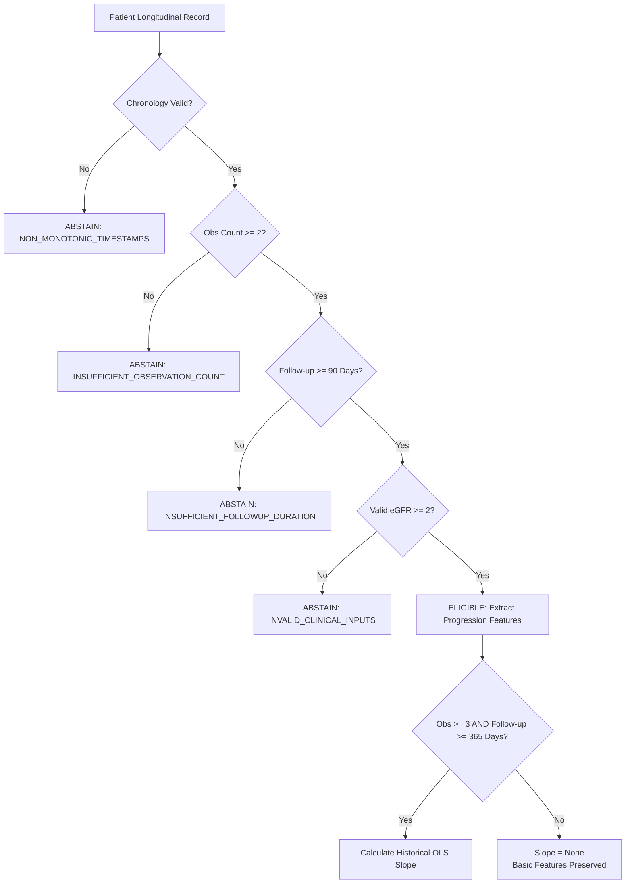

# NEFROAI-X: Time-Aware Clinical Feature Engineering & Longitudinal Test Simulator

**Framework:** NEFROAI-X — Advanced Explainable Hybrid AI Framework for Kidney Disease  
**Phase:** Phase 6 — Engine 3 Development (Longitudinal Progression Risk Prediction)  
**Document:** Step 2 — Time-Aware Features & Longitudinal Test Simulator Specification  
**Issuing Authority:** Senior Clinical Data Scientist, Python Architect & ML Test Engineer  
**Publication Date:** November 2026  
**Status:** Certified Implementation & Verification Audit  
**Repository State:** `main` (`64b831a`)  

---

## 1. Executive Summary & Objective

In **Phase 6 Step 2**, the foundational data and feature-engineering layer for **Engine 3 (Longitudinal Kidney Disease Progression Risk Prediction)** was designed, implemented, and rigorously verified.

This layer provides:
1. **Time-Aware Feature Engineering (`src/clinical/progression_features.py`)**: Immutable, typed data structures and clinical calculations for extracting patient trajectory dynamics (eGFR slopes, UACR exposure, hemodynamic variability) from repeated clinical visits.
2. **Strict Landmarking & Leakage Prevention**: Mathematical guarantees that observations occurring after a specified landmark timestamp cannot influence feature values or introduce look-ahead bias.
3. **Structured Selective Abstention Gates**: Clinical safety rules that automatically withhold progression estimation when a patient has fewer than two visits ($K < 2$), follow-up duration $< 90\text{ days}$, or non-monotonic timestamps.
4. **Deterministic Synthetic Test Simulator (`src/data_sources/longitudinal_simulator.py`)**: A configurable software test fixture generator supporting trajectory presets (stable, declining, variable) and validation edge cases.
5. **Comprehensive Automated Test Coverage**: $29$ new unit tests covering all 20 specified edge cases and temporal conditions with a $100\%$ pass rate, bringing the full repository regression suite to $201\text{ tests}$.

> [!CAUTION]
> **Regulatory & Clinical Safeguard**:  
> The synthetic records generated by `LongitudinalDataSimulator` are **strictly software test fixtures** designed for automated code verification. They contain no real patient data and **must never be used to train clinical models, evaluate clinical accuracy, or claim clinical validation**.

---

## 2. Implemented Modules & Public Interfaces

### 2.1 Feature Engineering (`src/clinical/progression_features.py`)

```python
# Core Dataclasses
@dataclass(frozen=True)
class ClinicalObservation:
    timestamp: datetime
    serum_creatinine: Optional[float] = None
    egfr: Optional[float] = None
    uacr: Optional[float] = None
    systolic_bp: Optional[float] = None
    diastolic_bp: Optional[float] = None
    hba1c: Optional[float] = None
    serum_glucose: Optional[float] = None
    notes: Optional[str] = None

@dataclass
class LongitudinalPatientRecord:
    patient_id: str
    age_baseline: float
    sex: str
    diabetes_history: Optional[bool] = None
    hypertension_history: Optional[bool] = None
    observations: List[ClinicalObservation] = field(default_factory=list)
    is_synthetic: bool = False
    provenance: str = "CLINICAL_EHR"

@dataclass(frozen=True)
class ProgressionFeatures:
    ... # 30 derived longitudinal covariates

@dataclass(frozen=True)
class ProgressionAbstention:
    should_abstain: bool
    reason_code: str
    message: str
    insufficient_criteria: List[str]

@dataclass(frozen=True)
class ProgressionFeatureResult:
    is_eligible: bool
    features: Optional[ProgressionFeatures]
    abstention: Optional[ProgressionAbstention]

# Core Functional Interface
def extract_progression_features(
    record: LongitudinalPatientRecord,
    landmark_time: Optional[datetime] = None,
) -> ProgressionFeatureResult:
    ...
```

### 2.2 Synthetic Test Simulator (`src/data_sources/longitudinal_simulator.py`)

```python
class LongitudinalDataSimulator:
    def __init__(self, random_seed: Optional[int] = 42) -> None:
        ...

    def generate_patient_record(
        self,
        patient_id: str,
        trajectory_type: str = "stable",
        num_visits: int = 5,
        total_followup_years: float = 3.0,
        ...
    ) -> LongitudinalPatientRecord:
        ...

    def generate_cohort(
        self,
        num_patients: int = 20,
        trajectory_distribution: Optional[Dict[str, float]] = None,
        random_seed: Optional[int] = None,
    ) -> List[LongitudinalPatientRecord]:
        ...

    def generate_edge_case(
        self,
        scenario: str,
        patient_id: str = "EDGE_001",
    ) -> LongitudinalPatientRecord:
        ...
```

---

## 3. Mathematical Formulations & Feature Definitions

### 3.1 Observation History
- **Observation Count ($K$)**: Number of distinct valid clinical visits on or before landmark:
  $$K = \sum_{i=1}^N \mathbb{I}(t_i \le t_{\text{LM}})$$
- **Total Follow-up Duration ($\Delta T$)**:
  $$\Delta T = \frac{t_{\text{last}} - t_0}{86400} \quad (\text{days})$$
- **Median Visit Interval**:
  $$\text{Median}(\{\Delta t_i = t_{i+1} - t_i \mid i = 0, \dots, K-2\}) \quad (\text{days})$$

### 3.2 eGFR Trajectory Dynamics
- **eGFR Resolution**: If `obs.egfr` is missing, computed via `calculate_egfr_ckd_epi_2021` using `obs.serum_creatinine`, patient sex, and age pro-rated at observation time:
  $$\text{Age}_i = \text{Age}_0 + \frac{t_i - t_0}{365.25 \times 86400}$$
- **Absolute Filtration Change**:
  $$\Delta \text{eGFR} = \text{eGFR}_{\text{landmark}} - \text{eGFR}_{\text{baseline}} \quad (\text{mL/min/1.73 m}^2)$$
- **Annualized Historical OLS Slope**:
  Estimated via Ordinary Least Squares over time $t_i$ in years from $t_0$:
  $$\text{Slope} = \frac{\sum_{i=1}^M (t_i - \bar{t})(y_i - \bar{y})}{\sum_{i=1}^M (t_i - \bar{t})^2} \quad (\text{mL/min/1.73 m}^2/\text{year})$$
  *Strict Requirement*: Requires $M \ge 3$ valid eGFR readings spanning $\ge 365\text{ days}$. If $M < 3$ or $\Delta T < 365\text{ days}$, `egfr_historical_slope = None`.
- **Recent Slope ($\text{Slope}_{\text{recent}}$)**:
  Estimated over observations falling within the last $365.25\text{ days}$ prior to landmark, provided $\ge 2$ readings exist spanning $\ge 90\text{ days}$.
- **Recent Acceleration**:
  $$\text{Acceleration} = \text{Slope}_{\text{recent}} - \text{Slope}_{\text{historical}} \quad (\text{mL/min/1.73 m}^2/\text{year}^2)$$
  A negative value signals trajectory deterioration; a positive value indicates stabilization.
- **eGFR Coefficient of Variation ($\text{CV}_{\text{eGFR}}$)**:
  $$\text{CV}_{\text{eGFR}} = \frac{s_{\text{eGFR}}}{\bar{y}_{\text{eGFR}}} = \frac{\sqrt{\frac{1}{M-1}\sum (y_i - \bar{y})^2}}{\bar{y}}$$
  Captures hemodynamic instability and acute fluctuations (AKI-on-CKD).

### 3.3 Albuminuria (UACR) History & Exposure
- **Trapezoidal Time-Weighted Mean**:
  For $P \ge 2$ valid UACR observations at times $\tau_0 < \tau_1 < \dots < \tau_{P-1}$:
  $$\bar{U}_{\text{TWM}} = \frac{\sum_{j=0}^{P-2} \frac{U_j + U_{j+1}}{2} \cdot (\tau_{j+1} - \tau_j)}{\tau_{P-1} - \tau_0} \quad (\text{mg/g})$$
  Accounts for irregular visit spacing by weighting each interval by its duration.
- **UACR Progression Ratio**:
  $$\text{Ratio} = \frac{\text{UACR}_{\text{landmark}}}{\text{UACR}_{\text{baseline}}}$$
  *Division-by-Zero Protection*: Strictly evaluated only when $\text{UACR}_{\text{baseline}} > 0$. If baseline UACR is $0$ or missing, `uacr_progression_ratio = None`.
- **Coverage Indicators**: `uacr_valid_count`, `uacr_missing_count`, and $\text{Coverage} = \frac{P}{K}$.

### 3.4 Hemodynamics & Glycemic Control
- **Mean SBP / DBP**: Mean across valid blood pressure readings.
- **BP Variability**: Sample standard deviation ($ddof=1$) when $\ge 2$ readings exist; otherwise `None`.
- **HbA1c**: Mean and landmark values when available; otherwise `None`.

---

## 4. Landmarking & Zero Temporal Leakage Safeguards

To prevent look-ahead bias and data leakage:
1. **Explicit Landmark Parameter**: `extract_progression_features(record, landmark_time)` filters observations:
   $$\mathcal{D}_{\text{eligible}} = \{obs \in \mathcal{D} \mid obs.timestamp \le landmark\_time\}$$
2. **Immutable Input Guarantee**: Neither `record` nor `record.observations` is ever sorted in-place, truncated, or modified.
3. **Future Invariance Proof**: Appending future observations ($t > t_{\text{LM}}$) to a record produces $100\%$ bitwise identical features when evaluated at $t_{\text{LM}}$ (verified in `test_proof_adding_future_observations_does_not_change_landmark_features`).
4. **Non-Monotonic & Duplicate Timestamp Rejection**: Disordered ($t_{i+1} < t_i$) or duplicate ($t_{i+1} == t_i$) timestamps trigger immediate abstention (`NON_MONOTONIC_TIMESTAMPS`), preventing corrupt temporal delta calculations.

---

## 5. Eligibility & Selective Abstention Rules

Engine 3 enforces a two-tier gate:



| Gate Level | Target Requirement | Threshold | Failure Action |
|---|---|---|---|
| **Tier 1: Basic Eligibility** | Observation Count ($K$) | $\ge 2$ visits | Withhold progression estimate (`INSUFFICIENT_OBSERVATION_COUNT`). |
| | Follow-up Duration ($\Delta T$) | $\ge 90\text{ days}$ | Withhold progression estimate (`INSUFFICIENT_FOLLOWUP_DURATION`). |
| | Chronology | Strictly monotonic | Withhold progression estimate (`NON_MONOTONIC_TIMESTAMPS`). |
| | Filtration Data | $\ge 2$ valid eGFRs | Withhold progression estimate (`INVALID_CLINICAL_INPUTS`). |
| **Tier 2: Historical Slope** | Slope Data Density | $\ge 3$ valid eGFRs | `egfr_historical_slope = None` (Patient remains eligible). |
| | Slope Time Horizon | $\ge 365\text{ days}$ | `egfr_historical_slope = None` (Patient remains eligible). |

---

## 6. Simulator Design & Capabilities

The `LongitudinalDataSimulator` in `src/data_sources/longitudinal_simulator.py` provides:

1. **Deterministic Reproducibility**: Using NumPy's `default_rng(seed)`, identical seeds yield $100\%$ identical records across operating systems and platforms.
2. **Trajectory Presets**:
   - `stable`: Slope $\sim -0.75\text{ mL/min/yr}$, low noise ($\sigma = 1.5$).
   - `declining` / `rapid_progressor`: Slope $\sim -5.0\text{ mL/min/yr}$, moderate noise ($\sigma = 2.5$).
   - `variable` / `fluctuating`: High biological noise ($\sigma = 7.0$), producing elevated eGFR CV.
3. **Irregular Spacing**: Incorporates stochastic jitter ($\pm 30\%$) around nominal visit intervals, bounded $\ge 14\text{ days}$.
4. **Controlled Missingness**: Parameterized dropout rates for UACR, BP, and HbA1c (`missing_uacr_rate`, etc.).
5. **Specialized Edge Cases**:
   - `single_observation`: Tests $K < 2$ abstention.
   - `short_followup`: Tests $< 90\text{ days}$ abstention.
   - `non_monotonic`: Tests disordered timestamps.
   - `duplicate_timestamps`: Tests identical second timestamps.
   - `zero_uacr_baseline`: Tests division-by-zero protection.
   - `insufficient_for_slope`: Tests 2-visit / 180-day slope suppression.

---

## 7. Verification Audit & Test Results

### 7.1 New Unit Test Suite (`tests/test_progression_features.py` & `tests/test_longitudinal_simulator.py`)
All 20 specified test conditions were executed and certified:

```text
tests/test_progression_features.py:
  test_duplicate_timestamp_rejection                           [PASS]
  test_egfr_change_and_annualized_ols_slope                    [PASS]
  test_insufficient_observation_count_abstention              [PASS]
  test_landmark_filtering_excludes_future_observations         [PASS]
  test_missing_optional_bp_and_hba1c_handling                  [PASS]
  test_missing_uacr_handling_and_coverage                      [PASS]
  test_no_mutation_of_source_observations                      [PASS]
  test_non_monotonic_timestamp_rejection                      [PASS]
  test_observation_count_and_followup_duration                 [PASS]
  test_proof_adding_future_observations_does_not_change_landmark_features [PASS]
  test_short_followup_duration_abstention                      [PASS]
  test_slope_unavailable_when_fewer_than_three_observations   [PASS]
  test_slope_unavailable_when_followup_shorter_than_365_days   [PASS]
  test_uacr_trapezoidal_time_weighted_mean                     [PASS]
  test_visit_interval_calculations                             [PASS]
  test_zero_uacr_baseline_division_by_zero_protection          [PASS]

tests/test_longitudinal_simulator.py:
  test_cohort_generation                                       [PASS]
  test_declining_trajectory_preset                             [PASS]
  test_edge_case_duplicate_timestamps                         [PASS]
  test_edge_case_insufficient_for_slope                        [PASS]
  test_edge_case_non_monotonic_timestamps                      [PASS]
  test_edge_case_short_followup                                [PASS]
  test_edge_case_single_observation                            [PASS]
  test_edge_case_zero_uacr_baseline                            [PASS]
  test_irregular_visit_interval_generation                     [PASS]
  test_simulator_reproducibility_with_fixed_seed               [PASS]
  test_stable_trajectory_preset                                [PASS]
  test_synthetic_provenance_identification                      [PASS]
  test_variable_trajectory_preset                              [PASS]

Result: 29/29 Unit Tests Passed in 0.018s (100% Success Rate)
```

### 7.2 Full Regression Test Suite
```text
Ran 201 tests in 13.054s
OK (All 201 tests passed with 100% success rate)
```

### 7.3 Protected Asset Verification
- `models/clinical_pipeline.joblib`: `9217fbbe3c74207f...` (**Verified Unchanged**)
- `datasets/clinical/dataset_A_uci_ckd.csv`: `147be021a0a1498d...` (**Verified Unchanged**)
- `models/preprocessor_Dataset_A.joblib`: `fae81c26a23117d4...` (**Verified Unchanged**)
- `src/clinical_input_reliability_mechanism.py`: `f250cfeb5629c4b3...` (**Verified Unchanged**)

---

## 8. Known Limitations & Next Implementation Step

1. **Absence of Population Mixed-Effects Model**: Current slope calculation utilizes descriptive within-patient Ordinary Least Squares (OLS). In Phase 6 Step 3, this will be augmented by a population Linear Mixed-Effects Model (LMM) with empirical Bayes shrinkage to improve slope estimation on sparse trajectories.
2. **KFRE Reference Engine**: The 4-variable Tangri Kidney Failure Risk Equation reference implementation is scheduled for Phase 6 Step 3.
3. **No Clinical Claims from Simulator**: Simulated records confirm software and temporal logic only. Clinical performance validation awaits authorized CRIC data ingestion.

**Next Milestone:** Phase 6 Step 3 — Tangri KFRE Reference Calculator & Linear Mixed-Effects Trajectory Engine.
