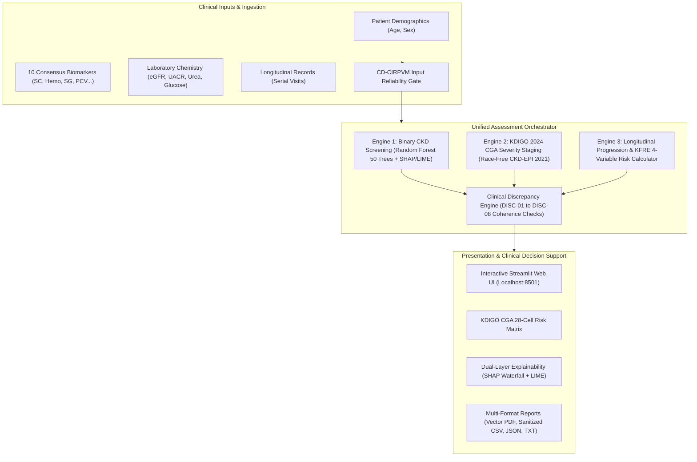
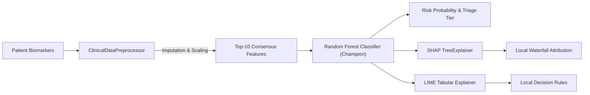
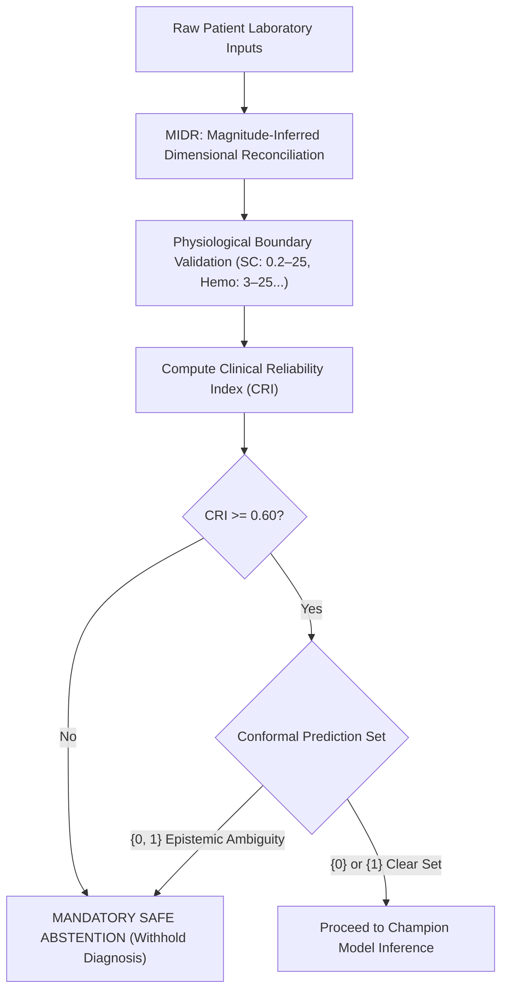
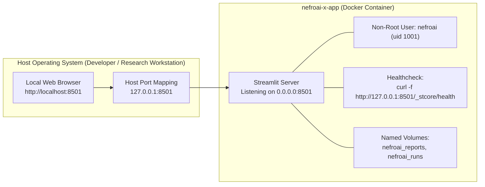

# NEFROAI-X Architecture & Workflow Diagram Index

This directory contains visual architecture diagrams and workflow specifications for the NEFROAI-X Chronic Kidney Disease (CKD) Clinical Decision Support System.

All diagrams are available in both **Scalable Vector Graphics (SVG)** format and **Mermaid diagram code blocks**.

---

## 1. Complete System Architecture

SVG File: [`nefroai_x_complete_architecture.svg`](file:///c:/Users/B%20Ranjith/Downloads/project/docs/images/nefroai_x_complete_architecture.svg)



---

## 2. Engine 1 Architecture (Screening & Explainability)

SVG File: [`engine1_architecture.svg`](file:///c:/Users/B%20Ranjith/Downloads/project/docs/images/engine1_architecture.svg)



---

## 3. Engine 2 Architecture (KDIGO 2024 CGA Staging)

SVG File: [`engine2_architecture.svg`](file:///c:/Users/B%20Ranjith/Downloads/project/docs/images/engine2_architecture.svg)

```mermaid
flowchart TD
    subgraph In["Biomarker Inputs"]
        SC["Serum Creatinine (mg/dL)"]
        AgeSex["Age &amp; Biological Sex"]
        UACR["Urine Albumin-to-Creatinine Ratio (mg/g)"]
    end

    subgraph Equations["Equations &amp; Guidelines"]
        CKDEPI["Race-Free CKD-EPI 2021 eGFR Equation"]
        GFRCat["GFR Category Assignment: G1 to G5"]
        AlbCat["Albuminuria Category Assignment: A1 to A3"]
        Grid["28-Cell KDIGO Composite Risk Heatmap"]
    end

    subgraph Out["Staging Outputs"]
        CGA["CGA Severity String (e.g., G3bA2)"]
        RiskLevel["Composite Risk Tier (Low / Moderately High / High / Very High)"]
        ChronAlert["Chronicity Verification Advisory (DISC-03)"]
    end

    SC &amp; AgeSex --> CKDEPI --> GFRCat
    UACR --> AlbCat
    GFRCat &amp; AlbCat --> Grid
    Grid --> CGA &amp; RiskLevel &amp; ChronAlert
```

---

## 4. Engine 3 Architecture (Progression & Survival Framework)

SVG File: [`engine3_architecture.svg`](file:///c:/Users/B%20Ranjith/Downloads/project/docs/images/engine3_architecture.svg)

```mermaid
flowchart TD
    subgraph Longitudinal["Serial Observations"]
        Visits["Time-Stamped Clinical Lab Visits (SC, eGFR, UACR)"]
        OLS["Ordinary Least Squares (OLS) Annual Slope"]
        LMM["Linear Mixed-Effects Model (LMM + BLUP Shrinkage)"]
    end

    subgraph KFRE["Tangri 4-Variable KFRE Reference"]
        KFREInputs["Age, Sex, eGFR, log(UACR)"]
        Calib["Regional Baseline Calibration (North America / International)"]
        KFRERisk["2-Year &amp; 5-Year Kidney Failure Risk (%)"]
        Gate["Eligibility Gate: eGFR &lt; 60 mL/min (DISC-05)"]
    end

    subgraph Survival["Survival Analysis Architecture"]
        Cox["Cox Proportional Hazards Baseline"]
        RSF["Random Survival Forest"]
        AJ["Aalen-Johansen Cumulative Incidence"]
        Defer["Status: DEFERRED_PENDING_APPROVED_COHORT"]
    end

    Visits --> OLS &amp; LMM
    Visits --> KFREInputs --> Gate --> Calib --> KFRERisk
    Visits -.-> Cox &amp; RSF &amp; AJ --> Defer
```

---

## 5. Unified Assessment Workflow

SVG File: [`unified_assessment_workflow.svg`](file:///c:/Users/B%20Ranjith/Downloads/project/docs/images/unified_assessment_workflow.svg)

```mermaid
sequenceDiagram
    autonumber
    actor Clinician as User / Clinician
    participant UI as Streamlit UI
    participant Orch as UnifiedAssessmentEngine
    participant E1 as Engine 1 (Screening)
    participant E2 as Engine 2 (Staging)
    participant E3 as Engine 3 (Progression)
    participant Disc as Discrepancy Engine

    Clinician->>UI: Enter patient labs or load preset
    UI->>Orch: assess_patient(UnifiedAssessmentRequest)
    par Parallel Analysis
        Orch->>E1: Run screening &amp; XAI
        Orch->>E2: Run CKD-EPI 2021 &amp; KDIGO staging
        Orch->>E3: Run KFRE &amp; trajectory slope
    end
    E1-->>Orch: Engine1Result
    E2-->>Orch: Engine2Result
    E3-->>Orch: Engine3Result
    Orch->>Disc: Cross-audit results (DISC-01 to DISC-08)
    Disc-->>Orch: Discrepancy flags &amp; safety advisories
    Orch-->>UI: UnifiedAssessmentResponse
    UI->>Clinician: Display multi-engine cards &amp; export report
```

---

## 6. Clinical Reliability & Safe Abstention Workflow (CD-CIRPVM)

SVG File: [`clinical_reliability_abstention_workflow.svg`](file:///c:/Users/B%20Ranjith/Downloads/project/docs/images/clinical_reliability_abstention_workflow.svg)



---

## 7. Docker Deployment Topology

SVG File: [`docker_deployment_architecture.svg`](file:///c:/Users/B%20Ranjith/Downloads/project/docs/images/docker_deployment_architecture.svg)


